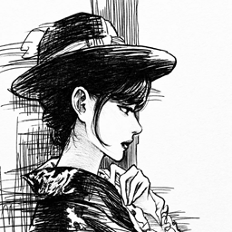
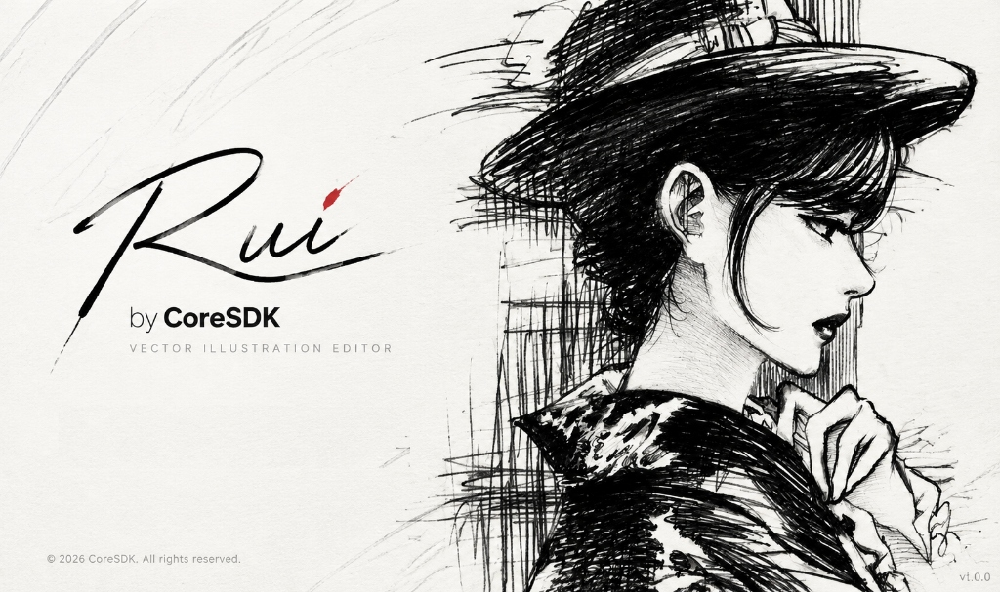

# Rui (by CoreSDK)

<p align="center">
  
</p>

<h1 align="center">Rui (by CoreSDK)</h1>

<p align="center">
  <b>现代化的开源矢量插画编辑器与 CDR 文件处理开发套件（纯 Rust 架构）</b><br>
  完整支持 CorelDRAW (<code>.cdr</code>) 原生文档解析、矢量图形编辑、位图自动矢量化、AI Agent 自动化对接及多格式跨平台导出。<br>
  原生支持 Windows、macOS、Linux 以及 WebAssembly 浏览器版本。
</p>

<p align="center">
  
</p>

<p align="center">
  
  
  
  
</p>

---

## 🌟 核心特性

1. **原生 CDR 解析与转换 (`crates/cdr`)**
   - 纯 Rust 实现的 Clean-room CDR 格式解析器，无需依赖任何专有商业运行环境。
   - 支持多页面、图层、曲线与节点、艺术文本与段落文本、颜色填充与轮廓属性的完整读取。
2. **桌面矢量编辑 GUI (`apps/tracedraw`)**
   - 界面名称：**Rui**，启动界面：墨韵国风专属欢迎画面，命令与包名：**rui-cdr**。
   - 默认开启简体中文（`zh-CN`），全套快捷键、渐变填充、调和（Blend）、封套扭曲（Envelope）、透视、对齐与分布。
3. **无头命令行工具 (`apps/tracedraw-cli` -> `rui-cdr-cli`)**
   - `rui-cdr-cli info <file.cdr>`：结构化输出矢量图元、文本及尺寸信息。
   - `rui-cdr-cli convert <in.cdr> <out.png|out.svg|out.pdf|out.dxf>`：批量自动化格式转换。
4. **AI 与自动化赋能 (`scripts/ai/`)**
   - 原生支持与 AI 编程助手（Antigravity / Claude / Cursor 等）通过命令行和 MCP 协议无缝对接。

---

## 🚀 编译与构建 (Build & CI/CD)

### 方案 A：通过 GitHub Actions 自动云端构建（推荐）
本项目已完整配置 `.github/workflows/build.yml`：
1. 将本项目推送到您的 GitHub 仓库；
2. 只要提交 `v*` 标签（例如 `git tag v0.19.6 && git push origin v0.19.6`），或在 Actions 页面点击 `Run workflow`；
3. GitHub 云端服务器会自动编译全套程序，并产出以下成品供您直接下载：
   - **`rui-cdr-<版本>-windows-x86_64-setup.exe`**（Windows 一键安装包）
   - **`rui-cdr-<版本>-windows-x86_64-portable.zip`**（Windows 绿色免安装版，内置 `rui-settings` 目录）
   - Linux AppImage / tar.gz 与 macOS DMG 安装镜像。

### 方案 B：本地编译（需 Rust 1.89+ 环境）

```bash
# 1. 编译 GUI 桌面应用
cargo build --release -p rui-cdr

# 2. 编译无头命令行工具
cargo build --release -p rui-cdr-cli

# 3. 运行主程序
./target/release/rui-cdr.exe

# 4. 运行命令行转换
./target/release/rui-cdr-cli.exe convert input.cdr output.png
```

---

## 🤖 AI 接入使用指南

在 `scripts/ai/` 目录下提供了 AI 对接脚本：

```bash
# 提取 CDR 结构信息（JSON 输出）
python scripts/ai/cdr_ai_tool.py info "your_drawing.cdr"

# 批量转换为图片或矢量格式
python scripts/ai/cdr_ai_tool.py convert "input.cdr" "output.svg"
```

---

## 📄 许可证与开源声明 (License & Attribution)

- **本项目版权**：Copyright &copy; 2026 rui.
- **上游基础**：本项目基于开源项目 TraceDraw 进行重塑与二次开发。
- **开源协议**：本项目依据 **MIT 协议** 或 **Apache-2.0 协议** 双重开源授权。
- 原始代码版权声明：Copyright &copy; 2026 Ighor Toth and the TraceDraw contributors.
- 第三方字体、图标及依赖资源遵循各自对应的开源许可证，完整信息保留于 `ATTRIBUTION.md`。
