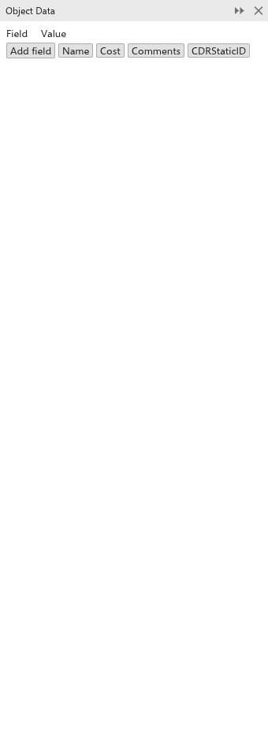

# Objektdaten

Das Andockfenster [[docker.object_data]] hängt einem Objekt Ihre eigenen
Informationen als benannte Felder an: eine Teilenummer, einen Preis, eine
Notiz. Die Daten werden mit der Zeichnung gespeichert und gehen mit dem Objekt
mit, wenn Sie es kopieren.

## Daten hinzufügen und bearbeiten {#fields}

1. Wählen Sie ein Objekt aus. Ist nichts ausgewählt, zeigt das Andockfenster
   [[docker.select_one_object]].
2. Das Andockfenster listet die Felder des Objekts in zwei Spalten auf,
   [[docker.field]] und [[docker.value]]. Klicken Sie auf einen Namen oder
   einen Wert, um ihn zu bearbeiten.
3. Klicken Sie auf [[docker.add_field]], um ein Feld hinzuzufügen, oder auf
   eine der Schaltflächen für ein gängiges Feld: Name, Cost, Comments und
   CDRStaticID.
4. Klicken Sie auf das **x** am Ende einer Zeile, um das Feld zu entfernen.

Wenn die ausgewählten Objekte ein Feld Cost mit einer Zahl haben, zeigt das
Andockfenster ihre Gesamtkosten an.

Einige Funktionen speichern eigene Daten in Objekten, etwa Bemaßungslinien,
Beschriftungen, Verbindungslinien und Anker; diese Felder müssen Sie selten von
Hand ändern.
