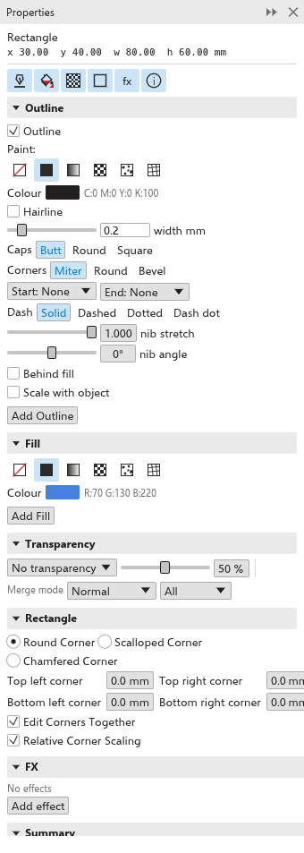

# Das Andockfenster Eigenschaften

Das Andockfenster [[docker.properties]] (<kbd>Alt+Enter</kbd>) zeigt und ändert
die Eigenschaften der ausgewählten Objekte: Umriss, Füllung, Transparenz und
mehr, je nachdem, was ausgewählt ist. Es ist anfangs geöffnet, neben
[[docker.hints]] und [[docker.objects]]. Öffnen Sie es erneut mit
[[menu.object > menu.object.properties]].

## Mit ausgewählten Objekten {#selection}

Oben im Andockfenster stehen der Name des ausgewählten Objekts (und wie viele
weitere ausgewählt sind) sowie seine Position und Größe. Darunter öffnet und
schließt eine Reihe von Schaltflächen jeden Abschnitt, den das Objekt hat:

- **QR-Code**, bei einem QR-Code: Inhalt und Aussehen; siehe
  [Strichcodes und QR-Codes](barcodes.md#qr-codes).
- [[docker.outline]]: Farbe, Breite, Farbauftrag, Enden, Ecken, Striche,
  Pfeilspitzen und mehr; siehe [Umrisse festlegen](../lines-shapes/outlines.md).
- [[docker.fill]]: die Art der Füllung und ihre Einstellungen; siehe
  [Füllungen](../color/fills.md). <kbd>F11</kbd> öffnet diesen Abschnitt.
- [[docker.transparency]]: wie viel vom Darunterliegenden durchscheint; siehe
  [Transparenz](../color/transparency.md).
- [[kind.rectangle]], bei Rechtecken: die Eckeneinstellungen; siehe
  [Ecken](../lines-shapes/rectangles-and-ellipses.md#rectangle-corners).
- [[docker.fx]]: die auf das Objekt angewendeten Bitmap-Effekte; siehe
  [Bitmap-Effekte](../effects/bitmap-effects.md).
- [[docker.character]], bei Text: Schrift, Größe, [[docker.bold]] und
  [[docker.italic]] sowie eine Schaltfläche [[docker.edit_with_text_tool]].
- [[docker.summary]]: eine Zusammenfassung des Objekts.

Abschnitte, die Sie geschlossen haben, bleiben beim nächsten Mal geschlossen.
Eine Änderung gilt für jedes ausgewählte Objekt und ist ein Rückgängig-Schritt.

## Ohne Auswahl {#defaults}

Ist nichts ausgewählt, zeigt das Andockfenster [[docker.no_objects_selected]]
und die [[docker.default_properties]]: die Füllung und den Umriss, die neue
Formen und Linien erhalten. Ändern Sie sie hier, um von Anfang an mit anderen
Farben zu zeichnen. Siehe
[Objektstile und Standardwerte](../templates-styles/object-styles.md#document-defaults).
