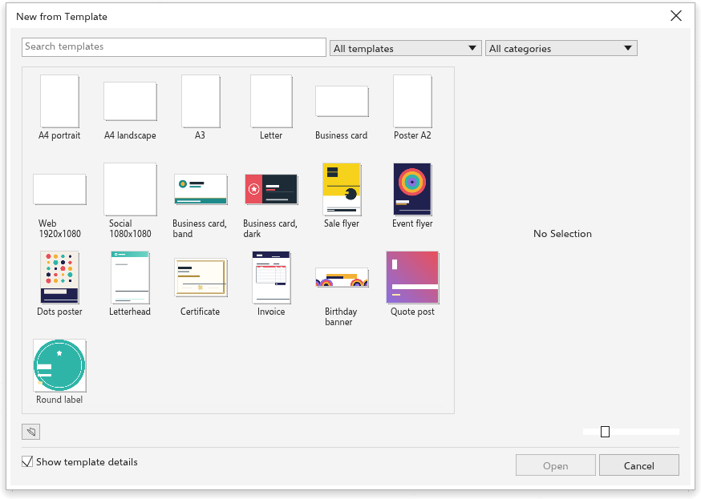

# Vorlagen

Eine Vorlage ist eine Zeichnung, mit der Sie beginnen: eine leere Seite in
einer gängigen Größe oder eine gestaltete Visitenkarte, ein Flyer, ein Poster,
ein Briefkopf oder ein Etikett zum Ausfüllen. Das Öffnen einer Vorlage erstellt
eine neue, unbenannte Zeichnung; die Vorlage selbst ändert sich nie.

## Mit einer Vorlage beginnen {#new-from-template}

1. Wählen Sie [[menu.file > menu.file.new_from_template]] oder klicken Sie auf
   dem Begrüßungsbildschirm auf Neu aus Vorlage.
2. Suchen Sie eine Vorlage:
   - Geben Sie in [[tpl.search]] etwas ein, um Namen und Kategorien zu
     durchsuchen;
   - wählen Sie die Herkunft der Vorlagen: [[tpl.all_templates]],
     [[tpl.built_in]] oder [[tpl.my_templates]];
   - wählen Sie eine Kategorie oder [[tpl.all_categories]].
3. Klicken Sie auf eine Vorlage, um sie anzusehen. Ist [[tpl.show_details]]
   eingeschaltet, zeigt der Bereich rechts sie groß mit [[tpl.category]],
   [[tpl.page_size]] und [[tpl.source]].
4. Klicken Sie auf [[tpl.open]], doppelklicken Sie auf die Vorlage oder
   drücken Sie <kbd>Enter</kbd>.

Der Regler [[tpl.thumbnail_size]] unten macht die Miniaturen größer oder
kleiner, und [[welcome.open_template]] öffnet jede `.tdt`- oder `.tdraw`-Datei
als Vorlage.

## Die integrierten Vorlagen {#built-in}

- **Leere Seiten**: A4 Hoch- und Querformat, A3, Letter, Visitenkarte (90 mal
  50 mm), A2-Poster, Web (1920 mal 1080 Pixel) und Social Media (1080 mal 1080
  Pixel).
- **Gestaltet**: zwei Visitenkarten, ein Angebotsflyer und ein
  Veranstaltungsflyer, ein Poster, ein Briefkopf, eine Urkunde, eine Rechnung,
  ein Geburtstagsbanner, ein Zitatbeitrag und ein rundes Etikett. Sie bestehen
  aus gewöhnlichen Formen und Text mit Beispieltext, sodass Sie jeden Teil
  ändern können.

## Eigene Vorlagen speichern {#save}

1. Erstellen Sie die Zeichnung, mit der Sie künftig beginnen möchten.
2. Wählen Sie [[menu.file > menu.file.save_as_template]].
3. Geben Sie ihr einen Namen und speichern Sie sie.

Gespeicherte Vorlagen erscheinen unter [[tpl.my_templates]]. Sie liegen im
Vorlagenordner Ihrer Einstellungen und sind daher in der Browserversion nicht
verfügbar.
