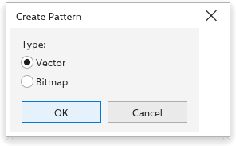

# Pattern fills

A pattern fill repeats a tile across the inside of an object. The tile can be
two colors, a set of vector objects (a full-color vector pattern) or a
bitmap. Tiles are anchored to the page, so they do not slide when you move
the object.

## Making a pattern from your objects {#create-pattern}

1. Draw the objects that make up one tile and select them.
2. Choose [[menu.object > menu.object.create > menu.object.create_pattern]].
3. In the [[dialog.create_pattern]] dialog box, choose the
   [[dialog.create_pattern_type]]: [[dialog.create_pattern_vector]] keeps the
   objects as vectors, sharp at any size; [[dialog.create_pattern_bitmap]]
   makes a picture of them.
4. Click [[dialog.ok]].

The pattern becomes the fill of new objects. To give it to objects you have
already drawn, choose [[docker.fill_pattern]] in the fill section of the
[[docker.properties]] panel.

## Pattern settings {#settings}

In the fill section of the [[docker.properties]] panel, choose
[[docker.fill_pattern]], then the kind of pattern and its settings. For a
vector pattern, the panel shows how many objects the tile holds, and its
width and height: changing them scales the content of the tile with it.

## Patterns in exported files {#export}

SVG files keep vector patterns as vectors. PDF and EPS files get them as
pictures at the export resolution, clipped to the object.
