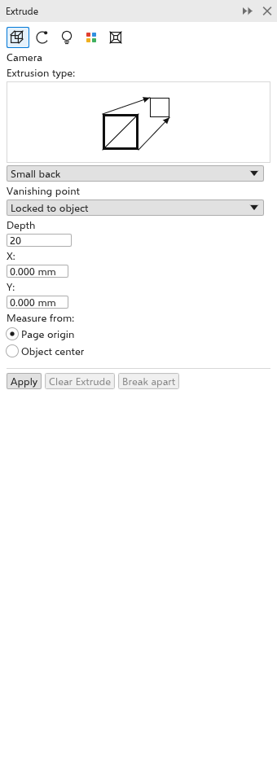

# Extrusions

An extrusion turns a flat object into a solid-looking body, with sides that
run from its outline to a copy of it, lit and shaded. It is a live effect:
change the object and the body follows.

## To extrude an object {#create}

With the tool:

1. Choose the [[tool.extrude]] tool from the Effects flyout.
2. Drag from an object. For a parallel extrusion the body runs along the drag;
   for the others the end of the drag is the vanishing point.
3. Drag the handle (a square with a cross) to move the vanishing point.

With the panel ([[menu.effects > menu.effects.extrude]], <kbd>Ctrl+F10</kbd>):
select an object, set the options and click [[docker.apply]].

Groups and bitmaps cannot be extruded.

## Extrusion settings {#settings}

The panel has five pages, chosen with the buttons at its top; the property bar
has the main settings and a 3D menu with the rest.

- **Camera**: the type of extrusion: small back (at first), big back, small
  front, big front, back parallel or front parallel. Back types grow behind
  the object, front types in front of it. The **depth** (1 to 99, 20 at
  first), the **vanishing point** (X and Y, counted from the page origin or
  the object's center), and whether it is **locked to the object** (moves
  with it) or to the page. For parallel types, X and Y are the offset.
- **Rotation**: turns the body in space about X, Y and Z (-360 to 360
  degrees); **Reset** puts it back.
- **Lighting**: the angle (135 degrees at first), intensity (50 at first) and
  elevation of the light, and two more lights you can turn on.
- **Color**: **Object fill** (the object's color, at first), **Solid** (one
  color) or **Shade** (a gradient from one color to another on each side).
- **Bevel**: a beveled edge on the front face, with its width.

**Clear extrude** removes the extrusion; **Break apart** turns the faces into
objects, grouped beside the object.
[[menu.object > menu.object.break_extrude_apart]] (<kbd>Ctrl+K</kbd>, also on
the right-click menu) does the same.
