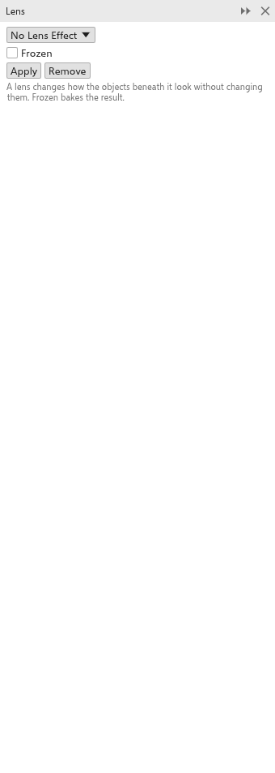

# Lenses

A lens changes how the objects beneath it look, without changing them: it can
brighten, tint, magnify, invert or apply bitmap effects to everything it
covers. Move the lens and the view through it changes. Lenses are set in the
[[docker.lens]] panel ([[menu.effects > menu.effects.lens]], <kbd>Alt+F3</kbd>).

## To make a lens {#create}

1. Draw a closed object over the objects to change, and select it.
2. In the [[docker.lens]] panel, choose the kind of lens and its settings.
3. Click [[docker.apply]].

## Kinds of lens {#kinds}

| Lens | What it does | Setting |
|---|---|---|
| Brighten | brightens (or darkens) what lies beneath | rate, -100 to 100 (50) |
| Color add | adds a color, as light | color and rate |
| Color limit | lets only a color through | color and rate |
| Custom color map | maps dark to light onto a range of colors | from and to colors, direction |
| Fish eye | bulges what lies beneath | rate, -1000 to 1000 (100) |
| Heat map | shows brightness as warm and cold colors | palette rotation |
| Invert | inverts the colors | |
| Magnify | enlarges what lies beneath | amount, 1 to 100 (2) |
| Tinted grayscale | shows it in shades of one color | color |
| Transparency | makes the lens see-through, tinted | rate and color |
| Wireframe | shows the objects as outlines | outline and fill colors |
| Bitmap effects | runs bitmap effects over what lies beneath | **Add effect**, in order |

## Options {#options}

- **Frozen**: keeps what the lens shows now, even when the objects beneath
  change.
- **Viewpoint**: shows another place through the lens.
- **Remove face**: shows the lens only over other objects, not over the empty
  page.

To add a bitmap effect as a lens from the effect picker, choose
[[menu.effects > menu.effects.picker]] and apply it as a lens.
