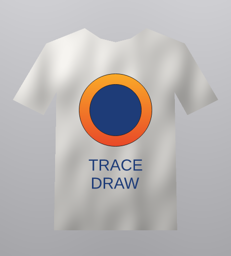
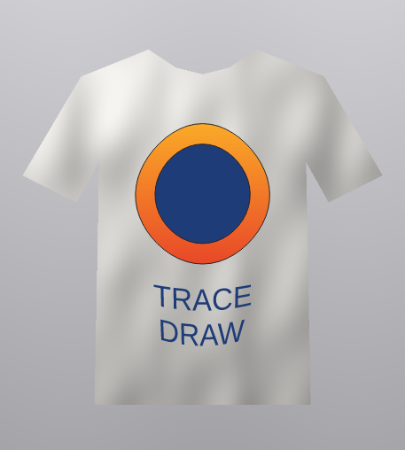
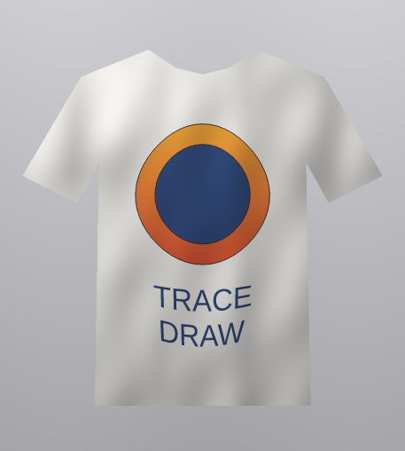
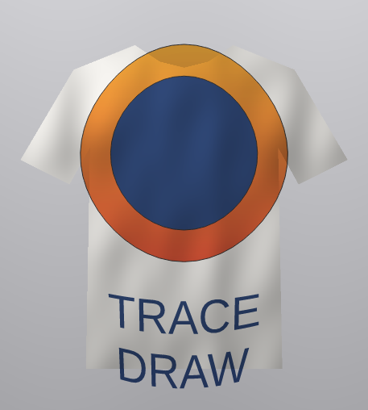
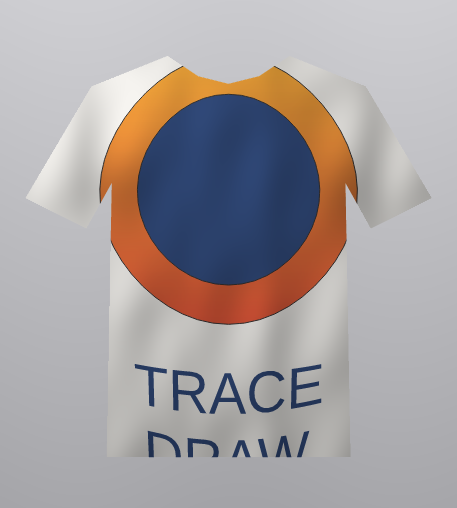

# Making a T-shirt mockup

A mockup shows a design on a photo of the real thing, here a T-shirt, so you
can judge it before it is printed. Four tools from the rest of this Help do
the work: an envelope bends the design over the chest, a transparency merge
mode lets the cloth's folds and shading show through the print, and a clip
frame keeps the print on the shirt.

## Place the photo and the design {#place}

1. Choose [[menu.file > menu.file.import]] and import a photo of a plain shirt,
   front view, in good light.
2. Draw or import your design, place it over the chest and size it there.
3. If the design is made of several objects, select them all and choose
   [[menu.object > menu.object.group]], so the next steps treat it as one.

## Follow the chest with an envelope {#envelope}

Cloth is not flat. A slight curve makes the print look as if it lies on the
shirt.

1. Select the design and choose the [[tool.envelope]] tool (or open
   [[menu.effects > menu.effects.envelope]]).
2. Use **[[envelope.single_arc]]** and drag the middle nodes a little: the bottom one down,
   the top one up and the side ones out. Keep it subtle.

Each object of a group is bent from the box of the whole group and keeps its
own colours. See [Envelopes](envelope.md).

## Let the cloth show through: Multiply {#multiply}

A print takes on the shading of the cloth under it. The **Multiply** merge mode
does the same: each color is multiplied by what is beneath, so the folds and
shadows of the photo darken the design where they darken the shirt.

1. Select the design and choose the [[tool.transparency]] tool, or open the
   transparency settings in the [[docker.properties]] panel.
2. Choose [[transparency.uniform]] and set the amount low (0 to 10 %).
3. Set [[transparency.merge_mode]] to **Multiply**.

See [Transparency](../color/transparency.md).

## Keep the print on the shirt: a clip frame {#clip}

A large print, or one placed near a sleeve, can reach past the shirt's edges.

1. Draw the outline of the shirt over the photo with the [[tool.bezier]] or
   [[tool.pen]] tool,
   following its edges (it does not need to be exact where the print does not
   reach). Give it no fill and no outline.
2. Select the design, choose
   [[menu.object > menu.object.clip_frame > menu.object.clip_frame_place_inside]]
   and click the outline.

The print is cut to the shirt and keeps its Multiply merge mode: it still
mixes with the photo beneath the frame. See
[Placing objects inside a frame](../objects/clip-frames.md).

## Tips {#tips}

- A white or light shirt shows Multiply best. On a dark shirt, try
  **If Lighter** for a light print, or keep **Normal** with a little
  transparency.
- To try another design, use [[menu.object.clip_frame_edit]], or
  [[menu.object.clip_frame_extract]], replace the design and place the new one
  inside again.
- Group the photo, the frame and the design to move the whole mockup.
