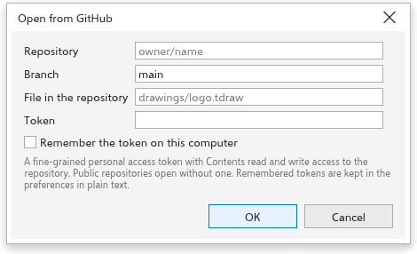
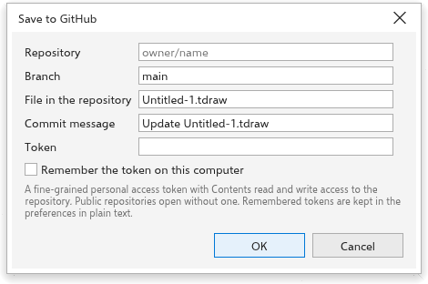
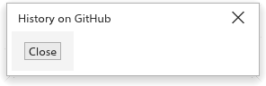

# Keeping drawings on GitHub

TraceDraw can open drawings from a GitHub repository and save them back as
commits, on the desktop and in the browser. Each save becomes a version in
the repository's history, which you can open again later. The commands are
in [[menu.file > menu.file.github]].

## Before you start: the token {#token}

Public repositories open without a token. To open private ones and to save,
create a fine-grained personal access token on GitHub with read and write
access to the contents of the repository, and paste it in the
[[github.token]] field.

The token is kept while TraceDraw runs. Tick [[github.remember_token]] to
keep it for the next time; it is then stored in plain text in your
preferences (in the browser, in that browser's storage). The dialog boxes
also remember the last repository, branch and path.

## Opening a drawing from GitHub {#open}

1. Choose [[menu.file > menu.file.github > menu.file.github_open]].
2. Type the [[github.repository]] as `owner/name` or its github.com address.
3. Type the [[github.branch]], or leave it empty for `main`.
4. Type the path of the [[github.path]], for example `art/logo.tdraw`.
5. Click [[dialog.ok]].

The drawing opens in a new tab, named after the file. It remembers where it
came from and which version it was.

## Saving a drawing to GitHub {#save}

For a drawing opened from GitHub, [[menu.file.save]] (<kbd>Ctrl+S</kbd>)
saves it back. For any drawing, choose
[[menu.file > menu.file.github > menu.file.github_save]].

1. Check the repository, branch and path.
2. Write a [[github.message]] that says what changed (it starts as
   "Update" and the file name).
3. Click [[dialog.ok]].

The drawing is saved as a `.tdraw` file, with its fonts, as a new commit on
that branch. [[menu.file.save_as]] still saves a file on your computer.

### When GitHub refuses a save {#conflict}

If the file changed on GitHub since you opened it, or a file already exists
at that path and your drawing did not come from it, GitHub refuses the save
and the dialog box says so. Save under another path or branch, or open the
newer version first. The dialog box also explains other problems: a token
that is refused or has no access, too many requests, a repository, branch or
file that does not exist, a path that is a folder, a file that is not a
drawing, or a drawing larger than 100 MB.

## Opening an earlier version {#history}

For a drawing opened from GitHub, choose
[[menu.file > menu.file.github > menu.file.github_history]]. The box lists the
commits that changed the file, newest first, with their short id, date,
author and message. Select one and click Open: that version opens as a new
drawing, named after the file and the commit, which is not tied to GitHub.

