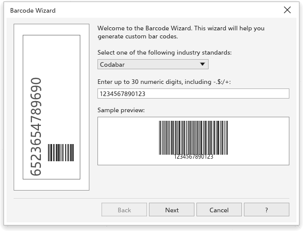

# Barcodes and QR codes

TraceDraw makes barcodes for products, labels and inventory, and QR codes
that phones can read. Both are made of ordinary vector shapes, so they print
sharp at any size.

## Making a barcode {#barcode}

Choose [[menu.object > menu.object.insert > menu.object.insert_barcode]] to open
the [[barcode.title]]. It has three steps; a [[barcode.sample_preview]] under
each shows the barcode as it will be made. Use [[barcode.next]] and
[[barcode.back]] to move between steps, and [[barcode.finish]] on the last one.

### Step 1: the standard and the data {#barcode-data}

Choose one of the standards and type the data. Choosing a standard puts a
sample in the field, and the wizard says what the standard accepts:

- **Codabar**: up to 30 digits and the signs `- $ : / . +`, between start and
  stop characters A to D.
- **Code 39**: capital letters, digits and `- . space $ / + %`.
- **Code 128**: any printable character.
- **EAN-13**, **EAN-8** and **UPC-A**: 12, 7 or 11 digits, or one more with
  the check digit, optionally followed by a space and a 2- or 5-digit add-on.
- **UPC-E**: 6 digits, or the number system (0 or 1) and 6 digits.
- **Interleaved 2 of 5**: up to 40 digits.

Data the standard cannot hold keeps you on this step with a message.

### Step 2: printer and sizes {#barcode-sizes}

- [[barcode.printer]]: the resolution of the printer, 150 to 2400
  [[barcode.dpi]] (300 at first). Bars are made a whole number of printer
  dots wide, so they print evenly.
- [[barcode.units]] for the sizes below.
- [[barcode.reduction]]: printer dots taken off every bar to make up for ink
  spreading (1 at first). The barcode keeps its width.
- [[barcode.magnification]]: 100% is the standard size.
- [[barcode.bar]] (1 inch at first), with the resulting
  [[barcode.symbol_width]].
- [[barcode.ratio]]: 2.0 to 3.0, for Codabar, Code 39 and Interleaved 2 of 5.
- [[barcode.advanced]] adds [[barcode.check_digit]] (Code 39 and Interleaved
  2 of 5) and the [[barcode.quiet_zone]], a white margin behind the bars in
  [[barcode.modules]].

### Step 3: the text {#barcode-text}

- The [[barcode.font]], [[barcode.size]] (12 points at first),
  [[barcode.weight]] and [[barcode.alignment]] of the readable text.
- Options, available where the standard uses them:
  [[barcode.center_sys_check]], [[barcode.text_above]],
  [[barcode.addon_text]], [[barcode.addon_bottom]], [[barcode.fact_data]],
  [[barcode.asterisks]], [[barcode.quiet_marks]] and [[barcode.start_stop]].
- [[barcode.human_readable]]: turn it off for bars without text.

[[barcode.finish]] places the barcode in the middle of the page as one group
and selects it.

## QR codes {#qr-codes}

Choose [[menu.object > menu.object.insert > menu.object.insert_qr]]. A QR code
is placed in the middle of the page at once, and the [[docker.properties]]
panel opens at its [[qr.section]] section:

1. Choose the kind of content: [[qr.kind_url]], [[qr.kind_email]],
   [[qr.kind_phone]], [[qr.kind_sms]], [[qr.kind_contact]], [[qr.kind_text]]
   or [[qr.kind_location]].
2. Fill in its fields, such as [[qr.field_url]], or [[qr.field_first_name]],
   [[qr.field_last_name]], [[qr.field_phone]] and [[qr.field_email]] for a
   contact. A field applies when you leave it. Fields the kinds share are
   kept when you change the kind.
3. Set the look: [[qr.dark_fill]] and [[qr.light_fill]] (any fill),
   [[qr.outline]] and [[qr.pixel_size]] (2.5 mm at first).
4. Click [[qr.validate]] to check that the code reads back. A green message
   says it does; a red one says why not, for example when the pixels are not
   dark enough against the background.

The QR code stays editable: move, scale or turn it as any object and change
its content later. To make it plain shapes, ungroup it. Content that cannot
be encoded, or too much of it, changes nothing and shows in red.
