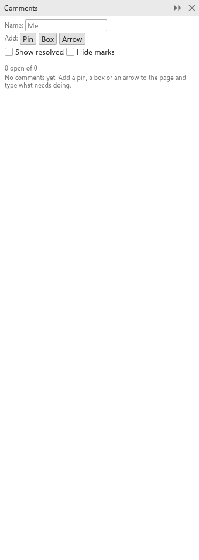

# Comments

The [[docker.comments]] panel collects review notes on a drawing: pins, boxes
and arrows on the page, each with a text and replies. Comments are saved with
the drawing (in `.tdraw` files) and are never printed or exported. Open the
panel from [[menu.window > menu.window.dockers]].

## Adding a comment {#add}

1. Type your name in [[comments.name]]. It signs your comments and replies.
   Left empty, the author of the drawing is used.
2. Next to [[comments.add]], click [[comments.pin]], [[comments.rect]] or
   [[comments.arrow]].
3. On the page, click to place a pin, or drag to draw a box around something
   or an arrow pointing at it.
4. Type the comment.

Each comment shows its number in an orange bubble on the page.

## Reading and answering {#list}

The panel lists the comments, with how many are open, each with its number,
author, date and time, page, text and replies. Click a card to choose the
comment and go to its page; with the panel open, you can also click a bubble
or a box on the page.

- Edit the text of the chosen comment, or type in the [[comments.reply_hint]]
  field and press <kbd>Enter</kbd> or click [[comments.reply]].
- [[comments.resolve]] marks a comment as dealt with; [[comments.reopen]]
  opens it again. Resolved comments are hidden unless
  [[comments.show_resolved]] is ticked.
- [[comments.hide_marks]] hides the bubbles, boxes and arrows on the page.
- [[comments.delete]] removes a comment and its replies.

Every change is one undo step. Deleting a page deletes its comments.
