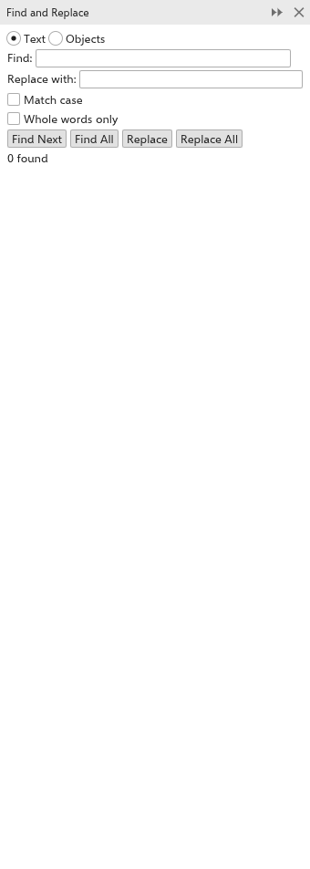

# Finding and replacing

The [[docker.find_replace]] panel (<kbd>Ctrl+F</kbd>) finds text in the
drawing, and replaces it, or finds objects by name. Open it with
[[menu.edit > menu.edit.find_and_replace]].

## Finding and replacing text {#text}

1. Choose [[dialog.find_text]].
2. Type what to look for in [[dialog.find]], and the new text in
   [[dialog.replace_with]].
3. Tick [[dialog.match_case]] to tell capitals from small letters, and
   [[dialog.whole_word]] to skip the text when it is part of a longer word.
4. Click [[dialog.find_next]] to select the next text object that holds it,
   or [[dialog.find_all]] to select them all.
5. Click [[dialog.replace]] to replace it in the selected text, or
   [[dialog.replace_all]] to replace it everywhere.

The panel says how many were found.

## Finding objects {#objects}

Choose [[dialog.find_objects]], type part of a name, or a kind of object such
as "Rectangle", and click [[dialog.find_next]] or [[dialog.find_all]]. The
search covers the current page. To name objects, see
[Renaming objects and layers](objects-and-layers.md#rename).
