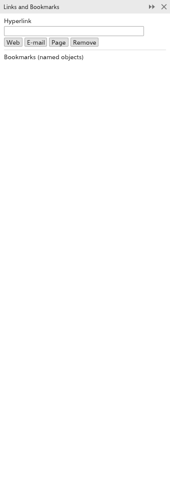

# Links and bookmarks

The [[docker.links]] panel gives objects a hyperlink, so a click on them in an
exported PDF, SVG or web page opens a web address, writes an email or goes to
another page. It also lists the named objects of the drawing as bookmarks.
Open it from [[menu.window > menu.window.dockers]].

## To add a link {#add}

1. Select one or more objects.
2. Type the address in the [[docker.hyperlink]] field and leave the field.
   The buttons [[docker.link_web]], [[docker.link_mail]] and
   [[docker.link_page]] put `https://`, `mailto:` or `#page=` in front of the
   text, so for a page link you only type its number.
3. Click [[docker.remove]] to take a link away, or empty the field.

## Bookmarks {#bookmarks}

Under [[docker.bookmarks]], the panel lists one button per object that has a
name. Click one to select the object and zoom to it. To name objects, see
[Renaming objects and layers](objects-and-layers.md#rename).

## Links in exported files {#exports}

- In PDF files, each linked object becomes a clickable area over its box. A
  page link goes to the top of that page of the file. PDF/X files get no
  links, as those standards do not allow them.
- In SVG and web pages, the object itself is the link.
- A link on a group covers all its objects; the links of the objects inside
  are left out.
