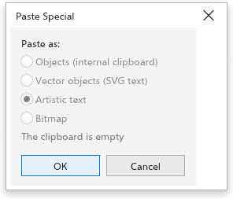

# Paste Special

[[menu.edit > menu.edit.paste_special]] chooses how the content of the
clipboard comes into the drawing, when it could come in more than one way:
for example text copied from another program can become a text object, and
an SVG copied from a web page can become editable shapes or a picture.

## To paste in another form {#paste-as}

1. Copy something, in TraceDraw or in another program.
2. Choose [[menu.edit > menu.edit.paste_special]].
3. Under [[dialog.paste_as]], choose one of the forms the clipboard offers:
   - [[dialog.paste_objects]]: objects copied in TraceDraw, as they were;
   - [[dialog.paste_svg]]: SVG text, turned into shapes you can edit;
   - [[dialog.paste_bitmap]]: an image, as a bitmap;
   - [[dialog.paste_text]]: plain text, as a line of text.
4. Click [[dialog.ok]].

When the clipboard holds nothing that can be pasted, the dialog box says
[[dialog.clipboard_empty]].

The ordinary [[menu.edit.paste]] (<kbd>Ctrl+V</kbd>) pastes in the first form
available, and [[menu.edit.paste_in_view]] (<kbd>Ctrl+Shift+V</kbd>) pastes
in the middle of the window.
