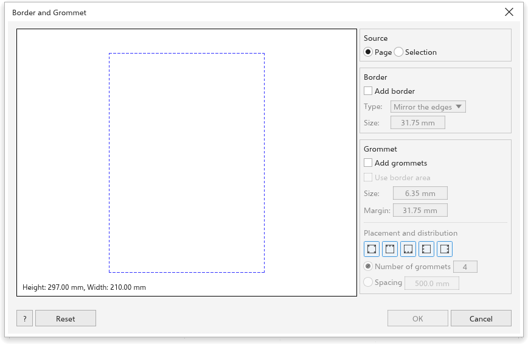

# Border and grommets

[[menu.tools > menu.tools.border_and_grommet]] finishes large prints such as
banners and canvases: it grows the page by a border and places grommet marks,
where the eyelets will be punched, along its edge.

The preview on the left shows the final page, the border band, the original
area (dashed) and the grommets, with the final height and width.

## Source {#source}

Choose **Page**, or **Selection** to make the box of the selected objects the
page.

## Border {#border}

Tick **Add border** and choose its **type**:

- **Mirror the edges**: the design is mirrored out into the border;
- **Stretch the edges**: the edge pixels are stretched out;
- **Solid color**: the border is filled with one color.

Set the **size** (31.75 mm at first), the same on every side. The design stays
where it is; mirrored and stretched edges are made from a picture of the
design, placed behind it, so your objects stay editable.

## Grommets {#grommets}

Tick **Add grommets**, then set:

- **Use border area**: center each grommet in the border band;
- **Size**: the diameter of the grommet (6.35 mm at first);
- **Margin**: from the outer edge to the grommet (31.75 mm at first).

Under **Placement and distribution**, choose the edges (corners, top, bottom,
left, right; all at first), then the **number of grommets per edge** (4 at
first) or the **spacing** between them. Corner grommets are shared by the two
edges. The grommets are drawn as thin circles on a layer of their own.

**Reset** puts every field back; [[dialog.ok]] is available when a border or
grommets are on.
