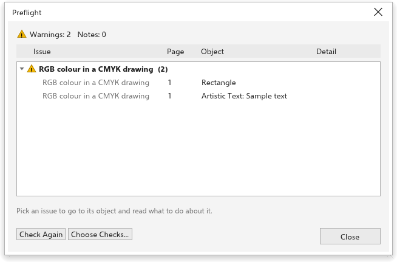

# Preflight

Preflight checks a drawing for what tends to go wrong in print, before you
print it or send it to a print shop. Choose [[menu.file > menu.file.preflight]].
The Print dialog box also runs the checks and shows how many issues it found.

## The checks {#checks}

| Check | Finds |
|---|---|
| Empty text object | text with nothing in it |
| Text does not fit its frame | paragraph text with hidden lines |
| Font not installed | text in a font that is not installed |
| Very small text | text smaller than 5 points as printed |
| Small text in rich black | small black text made of several inks |
| RGB color in a CMYK drawing | screen colors in a drawing meant for print |
| Object off the page | objects outside the page and its bleed |
| Low-resolution bitmap | bitmaps below 200 dpi as placed |
| Very high-resolution bitmap | bitmaps above 1200 dpi |
| Very thin outline | outlines thinner than 0.1 mm |
| White set to overprint | white that would vanish when printed |
| Empty page | pages with no objects |
| Objects that will not print | objects on hidden or non-printing layers |

Warnings are likely problems; notes are worth a look.

## Using the list {#list}

The top of the box shows the outcome. Each kind of issue has a heading with
its count; click it to open or close it. Click an issue to go to its page and
select its object. Under the list, the box says what to do about the kind you
picked.

- **Check again** runs the checks again after you fix things.
- **Choose checks** turns checks on and off and sets their limits: the bitmap
  resolutions, the smallest text sizes and the thinnest outline. **Defaults**
  puts them back.
