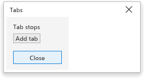
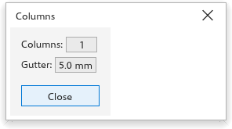
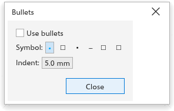
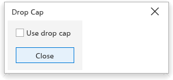

# Tabs, columns, bullets and drop caps

The [[menu.text]] menu has four dialog boxes for laying out paragraph text.
Each acts on the selected paragraph text. Their settings are also in the
**Frame** section of the [[docker.text]] panel.

## Tabs {#tabs}

[[menu.text > menu.text.tabs]] sets where the <kbd>Tab</kbd> character jumps
to. At first there is a tab stop every 12.7 mm (half an inch).

1. Select the paragraph text.
2. Choose [[menu.text > menu.text.tabs]].
3. Under [[dialog.tab_stops]], change the positions, or click
   [[dialog.add_tab]] to add one.
4. Click [[dialog.close]].

## Columns {#columns}

[[menu.text > menu.text.columns]] splits a text frame into columns; the text
flows from one column into the next.

1. Select the paragraph text.
2. Choose [[menu.text > menu.text.columns]].
3. Set the number of [[dialog.columns]] and the [[dialog.gutter]], the space
   between columns (5 mm at first).
4. Click [[dialog.close]].

To break to the next column at a given place, insert
[[menu.text.code_column_break]] from [[menu.text.insert_formatting_code]].

## Bullets {#bullets}

[[menu.text > menu.text.bullets]] puts a bullet before each paragraph.

1. Select the paragraph text.
2. Choose [[menu.text > menu.text.bullets]].
3. Tick [[dialog.use_bullets]], and set the bullet [[dialog.bullet_symbol]]
   and the [[dialog.bullet_indent]] (5 mm at first).
4. Click [[dialog.close]].

## Drop caps {#drop-cap}

A drop cap is a large first letter that spans several lines.

1. Select the paragraph text.
2. Choose [[menu.text > menu.text.drop_cap]].
3. Tick [[dialog.use_drop_cap]] and set the [[dialog.lines_dropped]] (3 at
   first).
4. Click [[dialog.close]].

The letter is scaled so its top meets the top of the first line and it sits
on the baseline of the last line it spans; the lines beside it are shortened
to make room.

## Hyphenation {#hyphenation}

[[menu.text > menu.text.use_hyphenation]] lets the selected text's words
break at the end of lines (while you type in a text, the paragraphs at the
cursor; with no text selected, it is the setting for new text), with at least two letters before and three after the break. A comma
or other punctuation next to a word does not stop it from breaking, and
words with an apostrophe (such as Italian *dell'anno*) break too. Words with
a capital letter are never broken. To decide yourself where a word may
break, see [Custom hyphens](writing-tools.md#custom-hyphens).
