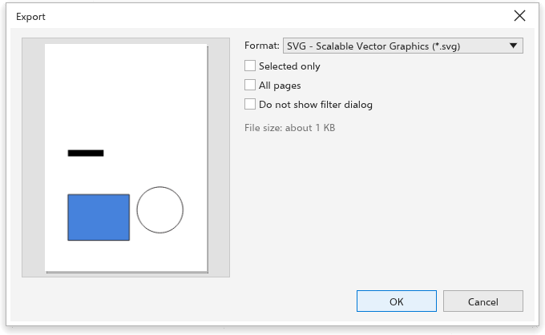

# Exporting for the web

[[menu.file > menu.file.export_for > menu.file.export_for_web]] opens the
Export dialog box set up for screens: PNG at 96 dpi. It keeps its own
settings, apart from [[menu.file.export]].
[[menu.file.export_for_office]] does the same for office documents (PNG at
150 dpi).

## Choosing a format {#formats}

- **PNG**: sharp edges and transparency; best for logos, icons and
  illustrations.
- **JPEG**: small files for photos; no transparency. Set the **quality** (1 to
  100).
- **WebP**: small files with transparency; set the quality.
- **GIF**: few colors, with transparency.
- **SVG**: vector graphics that stay sharp at any size and keep links and
  object names.
- **HTML**: a web page with the drawing.

## Size and resolution {#size}

For bitmap formats, set the **resolution**, or type the **width** or
**height** in pixels: the other side follows the proportions of the page. For
a 32 by 32 pixel icon, type 32. With **Transparent background** on, the empty
parts of the page stay transparent in PNG, WebP and GIF files.

**Selected only** exports only the selected objects, cropped to them; **All
pages** exports every page. The preview shows what will be written, and the
dialog box estimates the file size.

## Before exporting text {#text}

[[menu.text > menu.text.make_web_compatible]] simplifies text for the web.
To export many pages or objects at once, see
[The Export panel](export-docker.md).
