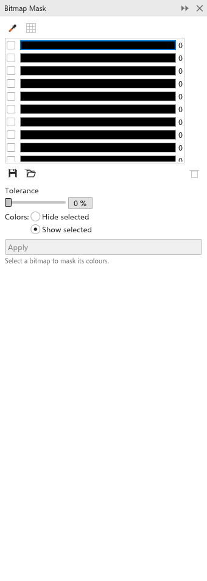

# Enmascarar colores de los mapas de bits

El panel [[docker.bitmap_mask]] oculta o conserva los píxeles de los colores
elegidos en un mapa de bits, por ejemplo para hacer transparente un fondo
blanco. Ábralo con [[menu.bitmaps > menu.bitmaps.bitmap_mask]].

## Para enmascarar colores {#mask}

1. Seleccione un mapa de bits.
2. Recoja colores en las diez casillas de color:
   - haga clic en el cuentagotas y luego en colores del mapa de bits; cada uno
     rellena la casilla seleccionada y la marca;
   - o haga clic en **Seleccionar colores del mapa de bits** para rellenar las
     casillas con los diez colores que más usa el mapa de bits.
3. Seleccione una casilla y ajuste su **tolerancia** (de 0 a 100%): cuánto
   puede alejarse el color de un píxel del color de la casilla y seguir
   coincidiendo.
4. Elija **Ocultar seleccionados** (los píxeles que coinciden se vuelven
   transparentes) o **Mostrar seleccionados** (solo quedan los píxeles que
   coinciden, opción inicial).
5. Haga clic en [[docker.apply]].

**Guardar máscara** y **Abrir máscara** guardan las casillas en un archivo
`.msk`; **Eliminar** vacía la casilla seleccionada. Cada mapa de bits cambia
en un solo paso de deshacer.
