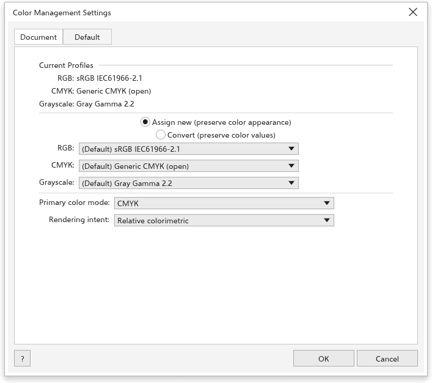

# Gestión del color

Las pantallas muestran los colores con luz roja, verde y azul; las impresoras
mezclan tintas cian, magenta, amarilla y negra. La gestión del color usa
**perfiles de color** para describir cada dispositivo, de modo que un color
conserve su aspecto desde la pantalla hasta la página impresa. Los ajustes
están en [[menu.tools > menu.tools.color_management]], el cuadro de diálogo
[[color_mgmt.title]]. Nada cambia hasta que hace clic en [[dialog.ok]].

## Los perfiles del dibujo {#document}

La pestaña [[color_mgmt.tab_document]] establece los perfiles del dibujo
activo.

- [[color_mgmt.current_profiles]] muestra los perfiles RGB, CMYK y de escala
  de grises que usa ahora el dibujo.
- Elija cómo se aplica un perfil nuevo:
  - [[color_mgmt.assign]]: los valores de color se mantienen y su aspecto
    cambia según el nuevo perfil;
  - [[color_mgmt.convert]]: los colores CMYK se convierten para que se vean
    igual en el nuevo perfil.
- Elija los perfiles [[color_mgmt.rgb_profile]], [[color_mgmt.cmyk_profile]]
  y [[color_mgmt.grayscale]]. Cada lista tiene los perfiles predeterminados y
  luego todos los perfiles encontrados en su equipo.
  [[color_mgmt.load_profiles]] añade archivos de perfil (`.icc`, `.icm`).
- [[color_mgmt.primary_mode]]: CMYK o RGB.
- [[color_mgmt.intent]]: cómo se adaptan los colores que no se pueden
  mostrar: [[color_mgmt.intent_relative]] (opción predeterminada),
  [[color_mgmt.intent_perceptual]], [[color_mgmt.intent_saturation]] o
  [[color_mgmt.intent_absolute]].

El perfil CMYK acompaña al dibujo, también en los archivos `.cdr` a partir de
la versión 16.

## Valores predeterminados para dibujos nuevos {#default}

La pestaña [[color_mgmt.tab_default]] establece lo que usan los dibujos nuevos
y cómo se convierten los colores.

- [[color_mgmt.preset]]: ajustes ya preparados para Norteamérica, Europa,
  Japón, o para trabajo web y en pantalla. [[color_mgmt.save_preset]] guarda
  sus propios ajustes con un [[color_mgmt.preset_name]];
  [[color_mgmt.delete_preset]] elimina uno.
- Los perfiles predeterminados [[color_mgmt.rgb_profile]],
  [[color_mgmt.cmyk_profile]] y [[color_mgmt.gray_profile]], el
  [[color_mgmt.primary_mode]] y el [[color_mgmt.intent]].
- [[color_mgmt.conversion]]:
  - [[color_mgmt.engine]]: [[color_mgmt.engine_icc]], que usa los perfiles, o
    [[color_mgmt.engine_builtin]];
  - [[color_mgmt.preserve_black]]: los colores hechos solo de tinta negra
    siguen siendo solo tinta negra al convertirlos;
  - [[color_mgmt.map_gray]] (activado de forma predeterminada): los grises
    convertidos a CMYK usan solo tinta negra;
  - [[dialog.black_point]] (activado de forma predeterminada): mantiene
    separados los tonos más oscuros.
- [[color_mgmt.open_policy]]: qué ocurre con el perfil de un archivo que abre,
  para RGB, CMYK y escala de grises: [[color_mgmt.open_use_embedded]],
  [[color_mgmt.open_assign_default]] o [[color_mgmt.open_convert_default]].
  [[color_mgmt.warn_mismatch_box]] y [[color_mgmt.warn_missing_box]] muestran
  un mensaje en la barra de estado cuando un archivo tiene otro perfil o
  ninguno.
- [[color_mgmt.import_policy]]: [[color_mgmt.import_convert]] o
  [[color_mgmt.import_assign]], para lo que importe o pegue.
- [[color_mgmt.spot_definition]]: si los colores planos se definen mediante
  [[color_mgmt.spot_lab]], [[color_mgmt.spot_cmyk]] o
  [[color_mgmt.spot_rgb]].

## Previsualizar los colores de impresión {#proof}

[[menu.view > menu.view.proof_colors]], o el botón de prueba del extremo
derecho de la barra de estado, muestra el dibujo como se imprimiría: los
colores que las tintas CMYK no pueden imprimir se ven más apagados. El panel
[[docker.color]] también avisa de esos colores.

Sin perfiles cargados, TraceDraw convierte los colores con su propio modelo de
tintas de cuatricromía sobre papel estucado.
