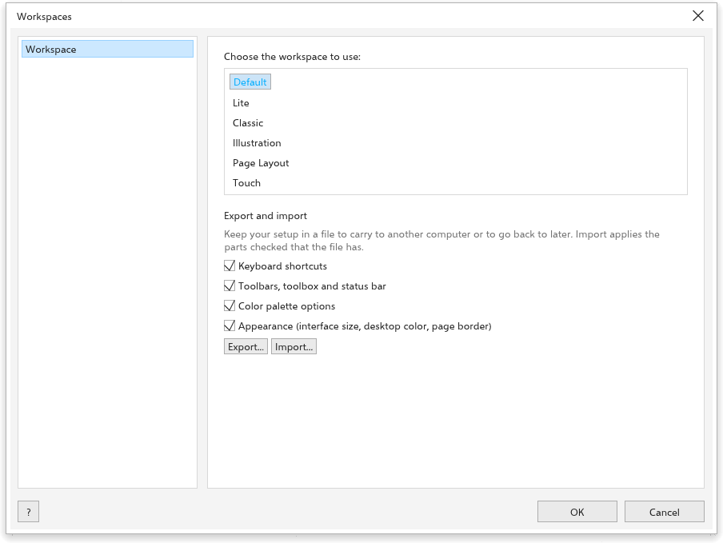

# Espacios de trabajo

Un espacio de trabajo es cómo está organizada la ventana: qué barras se
muestran y dónde, la caja de herramientas, los atajos de teclado, las opciones
de la paleta de colores y el aspecto de la interfaz. Elija uno en
[[menu.window > menu.window.workspace]], o en la página
[[options.workspace]] de
[[menu.tools > menu.tools.options > menu.tools.options_workspaces]].

## Espacios de trabajo integrados {#built-in}

- [[menu.window.workspace_default]]: la configuración habitual.
- [[menu.window.workspace_lite]]: menos barras, para empezar.
- [[menu.window.workspace_classic]], [[menu.window.workspace_illustration]] y
  [[menu.window.workspace_page_layout]]: barras y paneles para esos tipos de
  trabajo.
- [[menu.window.workspace_touch]]: para pantallas táctiles. La interfaz se
  dibuja más grande, las reglas, los paneles y la barra de estado se ocultan,
  y dos dedos desplazan la vista y pellizcan para hacer zoom con cualquier
  herramienta. Los dibujos conservan su tamaño real.

## Qué se conserva {#kept}

Todo lo que cambia se conserva cuando Rui se cierra y vuelve la próxima
vez: las opciones, dónde está cada barra y qué barras se muestran, la
herramienta que muestra cada grupo de la caja de herramientas, los paneles
abiertos, las unidades, el ajuste, los ajustes que toman los objetos nuevos y
lo que muestra la ventana.

## Exportar e importar su configuración {#export-import}

Para llevar su configuración a otro equipo, o guardarla a salvo:

1. En la página [[options.workspace]], en [[options.workspace_transfer]],
   marque las partes que incluir: atajos de teclado; barras de herramientas,
   caja de herramientas y barra de estado; opciones de la paleta de colores;
   apariencia.
2. Haga clic en [[options.workspace_export]] y guarde el archivo `.tdws`.
3. En el otro equipo, haga clic en [[options.workspace_import]] y elija el
   archivo. Solo se aplican las partes que marcó.

[[menu.window > menu.window.workspace > menu.window.workspace_export]] y
[[menu.window.workspace_import]] hacen lo mismo con todas las partes.
