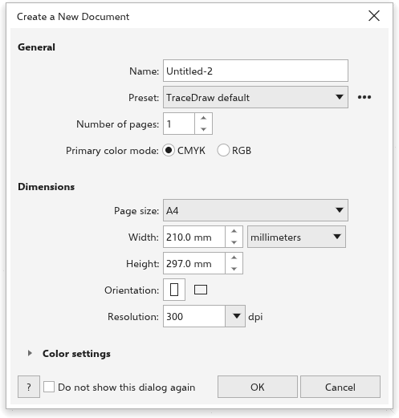

# Crear un dibujo

Todo dibujo empieza con un tamaño de página, un número de páginas, un modo de
color y una resolución. Se eligen en el cuadro de diálogo
[[dialog.create_new_document]].

## Para crear un dibujo {#create}

1. Elija [[menu.file > menu.file.new]] (<kbd>Ctrl+N</kbd>), haga clic en Nuevo
   en la barra de herramientas estándar, haga clic en el **+** después de la
   última pestaña de documento o haga clic en Nuevo documento en la pantalla de
   bienvenida.
2. En el cuadro de diálogo [[dialog.create_new_document]], defina los valores
   descritos abajo.
3. Haga clic en [[dialog.ok]] o pulse <kbd>Enter</kbd>.

El dibujo se abre en su propia pestaña. El cuadro de diálogo recuerda sus
valores para el siguiente dibujo.

## General {#general}

- [[dialog.name]] da nombre al dibujo. Empieza como el siguiente
  `Untitled-N`.
- [[newdoc.preset]] define a la vez el modo de color, el tamaño de página, las
  unidades y la resolución. Los valores predefinidos son
  [[newdoc.preset_default]] y [[newdoc.preset_cmyk]] (CMYK, A4, milímetros,
  300 ppp), [[newdoc.preset_rgb]] (RGB, A4, milímetros, 300 ppp) y
  [[newdoc.preset_web]] (RGB, 1920 x 1080 píxeles, 72 ppp). Cuando cambia uno
  de esos valores, el valor predefinido muestra [[newdoc.preset_custom]] salvo
  que los valores vuelvan a coincidir con uno.
- El botón junto al valor predefinido contiene [[newdoc.save_preset]], que pide
  un [[newdoc.preset_name]] y añade los valores actuales a la lista, y
  [[newdoc.delete_preset]], que quita uno que usted haya guardado. Los valores
  predefinidos incorporados no se pueden borrar.
- [[newdoc.pages]] define cuántas páginas tiene el dibujo, de 1 a 999. Cada
  página se llama "Page N" y tiene una capa.
- [[newdoc.color_mode]] es CMYK, para impresión, o RGB, para pantallas.

## Dimensiones {#dimensions}

- [[newdoc.page_size]] enumera los tamaños de papel, o Personalizado. Elegir un
  tamaño mantiene la orientación actual. Un ancho y un alto escritos que
  coinciden con un tamaño de papel, en cualquier orientación, seleccionan su
  nombre.
- [[newdoc.width]] y [[newdoc.height]] definen el tamaño de la página, en las
  unidades que elija en la lista junto al ancho. Esas unidades pasan a ser las
  unidades de dibujo de la barra de propiedades.
- [[newdoc.orientation]]: [[dialog.portrait]] o [[dialog.landscape]].
- [[newdoc.resolution]] en [[newdoc.dpi]] (300 de entrada). Se usa para los
  efectos que se convierten en píxeles y para medir tamaños en píxeles: 1920
  píxeles son 162,56 mm a 300 ppp y 677,33 mm a 72 ppp. Cuando las unidades
  son píxeles, cambiar la resolución mantiene el tamaño de la página en
  píxeles.

## Ajustes de color {#color-settings}

Abra [[newdoc.color_settings]] para elegir el [[newdoc.rgb_profile]], el
[[newdoc.cmyk_profile]] y el [[newdoc.gray_profile]] del dibujo y el
[[newdoc.intent]]. Empiezan en sRGB, el perfil CMYK incorporado, una escala de
grises con 20% de ganancia de punto y colorimétrico relativo. Vea
[Gestión del color](../color/color-management.md).

## Omitir el cuadro de diálogo {#skip}

Marque [[newdoc.dont_show]] para crear dibujos nuevos al momento, con los
últimos valores usados. Para volver a ver el cuadro de diálogo, active el
ajuste correspondiente en la página [[options.general]] de
[[menu.tools > menu.tools.options > menu.tools.options_app]]. Vea
[Opciones de TraceDraw](../customize/options-app.md#general).

## Otras formas de empezar {#other-ways}

- [[menu.file > menu.file.new_from_template]] empieza desde una plantilla. Vea
  [Plantillas](../templates-styles/templates.md).
- [[menu.file > menu.file.open]] abre un dibujo existente. Vea
  [Abrir y guardar dibujos](open-and-save.md).
