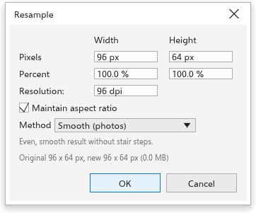
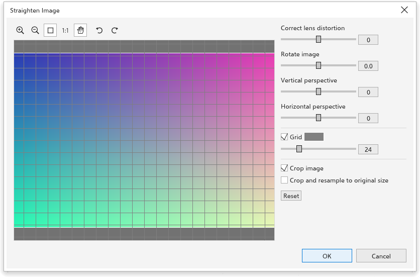
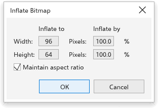

# Ricampionare, raddrizzare e ingrandire le bitmap

## Ricampiona {#resample}

[[menu.bitmaps > menu.bitmaps.resample]] dà alle bitmap selezionate un nuovo
numero di pixel; la loro dimensione sulla pagina resta invariata.

1. Digita la nuova dimensione in **pixel**, come **percentuale** o come
   **risoluzione** che ne risulta alla sua dimensione sulla pagina. Con
   **Mantieni proporzioni** attivo, l'altezza segue la larghezza.
2. Scegli il metodo:
   - **Morbido** (foto), in partenza;
   - **Nitido**, un po' più definito;
   - **Pixel netti** (pixel art): ogni pixel resta un quadrato di un solo
     colore;
   - **Ingrandisci con dettaglio**: morbido, poi reso più nitido quando
     l'immagine cresce.
3. Fai clic su [[dialog.ok]].

La finestra di dialogo mostra le dimensioni originali e nuove e la memoria
occupata dalla nuova immagine. Con più bitmap selezionate, ciascuna viene
scalata dello stesso fattore.

## Raddrizza immagine {#straighten}

[[menu.bitmaps > menu.bitmaps.straighten_image]] corregge le foto inclinate,
riprese di sbieco o deformate dall'obiettivo.

1. Usa la **Griglia** (dimensione e colore regolabili) per allineare
   l'immagine.
2. Imposta i cursori: **Correggi distorsione dell'obiettivo** (da -100 a 100),
   **Ruota immagine** (da -15 a 15 gradi), **Prospettiva verticale** e
   **Prospettiva orizzontale** (da -100 a 100). I pulsanti di rotazione
   girano prima l'immagine di un quarto di giro.
3. Con **Ritaglia immagine** attivo, il risultato viene ritagliato al
   rettangolo più grande con le proporzioni originali; **Ritaglia e ricampiona
   alla dimensione originale** lo riporta al numero di pixel originale. Senza
   ritaglio, gli angoli sono trasparenti.
4. Fai clic su [[dialog.ok]]. **Reimposta** riporta indietro ogni
   impostazione.

Ingrandisci e sposta l'anteprima con gli strumenti sopra di essa. Il risultato
sostituisce i pixel, quindi gli effetti applicati alla bitmap diventano
permanenti.

## Ingrandire le bitmap {#inflate}

Alcuni effetti, come le sfocature, si estendono oltre i bordi di una bitmap.

- [[menu.bitmaps > menu.bitmaps.inflate > menu.bitmaps.inflate_auto]] (attivo
  in partenza) ingrandisce le bitmap di quanto serve ai loro effetti, con un
  margine trasparente.
- [[menu.bitmaps.inflate_manual]] ingrandisce a mano le bitmap selezionate:
  per la larghezza e l'altezza, digita la nuova dimensione in pixel o una
  percentuale (da 100 a 1000%), con **Mantieni proporzioni**. L'immagine
  resta centrata.

## Altri comandi bitmap {#other}

- [[menu.bitmaps.crop_bitmap]] ritaglia una bitmap con lo strumento
  [[tool.crop]]; anche trascinare un angolo di una bitmap con lo strumento
  [[tool.shape]] la ritaglia.
- [[menu.bitmaps.edit_bitmap]] apre la bitmap in un altro programma.
- [[menu.bitmaps.remove_background]] rende trasparente lo sfondo di una foto.
- [[menu.bitmaps.remove_background_local]]: [Rimuovi sfondo](remove-background.md).
- [[menu.bitmaps.break_link]] e [[menu.bitmaps.update_from_link]] agiscono
  sulle bitmap collegate a un file.
- [[menu.bitmaps.save_bitmap_as]] salva una bitmap come file PNG.
