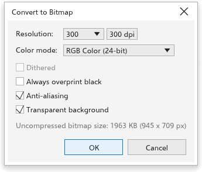

# オブジェクトをビットマップに変換する

[[menu.bitmaps > menu.bitmaps.convert_to_bitmap]] ([[menu.object > menu.object.convert_to_bitmap]] からも可能) は、選択したオブジェクトを一つのビットマップにします。複雑な作品を平坦化したり、オブジェクトにビットマップ効果をかける準備をしたりするのに使います。元に戻す操作 1 回分です。

## 設定 {#settings}

- **解像度**: 一覧から選ぶ (72 から 600 dpi) か、値を入力します (36 から 2400、最初は 300)。
- **カラーモード**: 白黒 (1 ビット)、グレースケール (8 ビット)、パレット (8 ビット)、RGB カラー (24 ビット、最初の設定)、CMYK カラー (32 ビット)。
- **ディザ**: 白黒とパレットで、ドットを混ぜて足りない濃淡を表現します。
- **常に黒をオーバープリント**: ビットマップの黒を下の色の上に重ねて印刷します。
- **アンチエイリアス** (最初はオン): 端を滑らかにします。オフにすると、ピクセルの端がくっきりします。
- **透明な背景** (最初はオン)。オフにすると、オブジェクトを白の上に置きます。

ダイアログボックスには、圧縮前のビットマップの大きさが表示されます。
