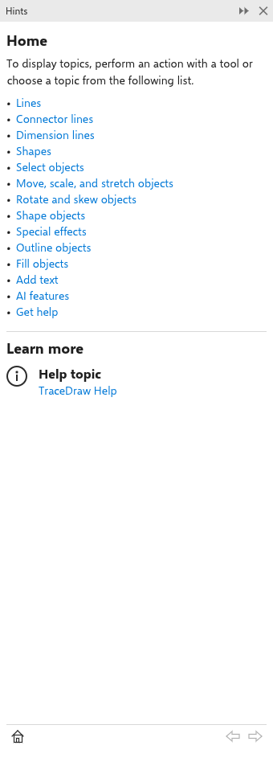

# ヒントパネル

[[docker.hints]] パネルは、使っているツールを使っている最中に説明します。最初は [[docker.properties]] と [[docker.objects]] の隣に開いています。[[menu.help > menu.help.hints]] または [[menu.window > menu.window.dockers]] から開き直せます。

## パネルに表示される内容 {#pages}

- **ホーム** ページはパネルを紹介し、線の描画、図形、選択、オブジェクトの移動と回転、効果、アウトライン、塗りつぶし、テキスト、AI、ヘルプの探し方といったトピックを一覧します。各トピックはリンクです。
- **トピック** ページはトピックを説明し、それに役立つツールを、アイコン、名前、機能とともに一覧します。ツールをクリックするとそのページが表示されます。
- **ツール** ページはツールの使い方を、キーを太字にして 1 行に一つずつ示し、そのツールを一覧しているトピックへのリンクを持ちます。

どのページも最後に [[hint.learn_more]] があり、そのツールやトピックを詳しく説明するこのヘルプのページにリンクしています。

## ページ間の移動 {#navigation}

別のツールを選ぶと、パネルにそのツールのページが表示されます。パネル下部のバーには、Web ブラウザーのように、左に [[hint.home]]、右に [[hint.back]] と進むボタンがあります。
