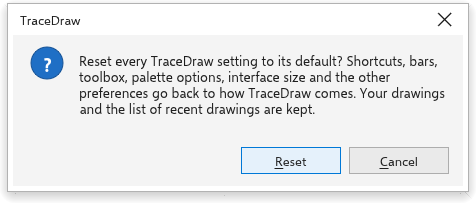

# Instellingen herstellen

Als uw instellingen in de war raken, kunt u alle voorkeuren terugzetten naar
hoe TraceDraw wordt geleverd. Uw tekeningen worden nooit aangeraakt.

## Alle instellingen herstellen {#reset}

- Kies [[options.reset_all]] op de pagina [[options.general]] van
  [[menu.tools > menu.tools.options > menu.tools.options_global]].
- Of druk op <kbd>F8</kbd> terwijl het opstartscherm wordt getoond als
  TraceDraw start.

TraceDraw vraagt het eerst. **Herstellen** zet alle voorkeuren terug, maar
behoudt de lijst met recente tekeningen, de laatste map en de grootte van het
venster. [[dialog.cancel]] verandert niets.

Om maar een deel te herstellen: de gereedschapskist en de balken hebben eigen
herstelopdrachten (zie [De werkruimte](../get-started/workspace.md#arranging)),
en het kiezen van een ingebouwde werkruimte stelt de eigen balken ervan in
(zie [Werkruimten](workspaces.md)).
