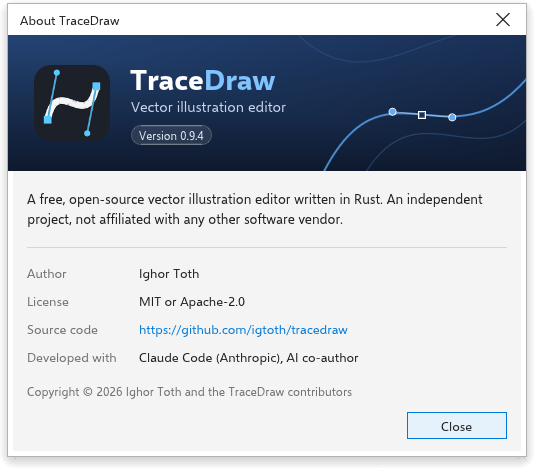
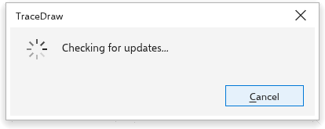

# Over TraceDraw en updates

TraceDraw is vrij en opensource. Deze pagina legt uit hoe u ziet welke versie
u hebt, hoe u een nieuwere krijgt en waar u hulp kunt vragen.

## Het venster Info {#about}

Kies [[menu.help > menu.help.about]] om de gebruikte versie, de auteur, de
licentie, een koppeling naar de broncode en de bouwstenen van het programma te
zien. Druk op [[dialog.close]], <kbd>Enter</kbd> of <kbd>Esc</kbd> om het te
sluiten.

## Naar updates zoeken {#updates}

Op de desktop kan TraceDraw u laten weten wanneer er een nieuwere versie is.

Zo controleert u nu:

1. Kies [[menu.help > menu.help.updates]].
2. TraceDraw vraagt de releasepagina van het project naar de nieuwste versie
   en zegt of die nieuwer is dan de uwe. Testversies en nachtelijke builds
   worden nooit aangeboden.
3. Als er een nieuwere versie is, kiest u wat u wilt doen:
   - **Downloaden** opent de download van het bestand voor uw systeem (het
     installatieprogramma of het draagbare archief op Windows, de
     schijfkopie voor de processor van uw Mac, de AppImage of het archief op
     Linux). Het installatieprogramma van uw systeem doet daarna de
     installatie.
   - **Releaseopmerkingen** opent de lijst met wijzigingen van die versie.
   - **Deze versie overslaan** biedt die versie niet meer aan.
   - [[dialog.close]] sluit het venster.

Als TraceDraw als Linux-AppImage draait, kan het venster ook **Installeren**
aanbieden: het downloadt de nieuwe AppImage naast de huidige, controleert of de
download volledig en echt is, en zet hem in de plaats van het oude bestand. De
nieuwe versie start de volgende keer dat u TraceDraw opent. Klopt er iets
niet, dan blijft het oude bestand zoals het was en zegt het venster waarom.

Mislukt de controle (bijvoorbeeld zonder internetverbinding), dan meldt het
venster dat en biedt het de releasepagina aan.

### Automatisch controleren {#automatic-check}

[[menu.tools > menu.tools.options > menu.tools.options_global]], pagina
[[options.general]], heeft een instelling om bij het starten naar updates te
zoeken. Die staat eerst aan: eens per dag controleert TraceDraw stil bij het
starten en meldt zich alleen als er een nieuwere versie is die u niet hebt
overgeslagen.

> **Opmerking:** De browserversie is altijd de nieuwste. Daar opent
> [[menu.help > menu.help.updates]] de releasepagina.

## Het welkomstscherm {#welcome-screen}

Het welkomstscherm is het eerste tabblad als TraceDraw start. Van daaruit maakt
u een tekening, opent u een van de laatst gebruikte tekeningen (elk met een
miniatuur; [[menu.file.clear_recent]] vergeet ze), begint u vanuit een
sjabloon, leest u het nieuws en vindt u leermateriaal. Kies
[[menu.help > menu.help.welcome_screen]] om het terug te halen.
[[menu.help > menu.help.video_tutorials]], [[menu.help.quick_start_guide]] en
[[menu.help.user_guide]] openen de leerpagina, en [[menu.help.whats_new]] het
nieuws.

## Gemeenschap en ondersteuning {#community}

- [[menu.help > menu.help.community]] opent het discussieforum van het
  project, waar u vragen kunt stellen en ideeën kunt delen.
- [[menu.help > menu.help.support]] opent de issuetracker, waar u een probleem
  kunt melden.
- [[menu.help > menu.help.message_settings]] opent de opties waarin de
  meldingen van TraceDraw worden ingesteld.
