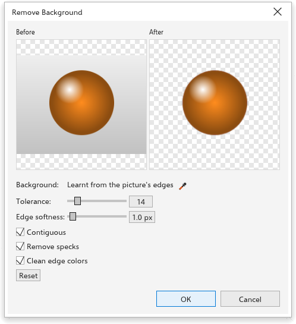

# Remover o fundo de um bitmap

[[menu.bitmaps > menu.bitmaps.remove_background_local]] deixa transparente o
fundo de uma foto ou digitalização e mantém o assunto. Funciona neste
computador e não precisa de serviço de IA. A barra de propriedades de um
bitmap selecionado tem o mesmo comando.

## Para remover um fundo {#remove}

1. Selecione um ou mais bitmaps.
2. Clique em [[menu.bitmaps > menu.bitmaps.remove_background_local]]. A
   prévia mostra o bitmap antes e depois, com um quadriculado onde ele fica
   transparente.
3. Ajuste as opções abaixo até o assunto se destacar de forma limpa.
4. Clique em [[dialog.ok]]. Todos os bitmaps selecionados mudam em uma única
   etapa de desfazer.

## Opções {#options}

- **[[dialog.bg_colors]]** O TraceDraw aprende as cores do fundo nas bordas da
  imagem (até quatro, então um degradê ou um fundo de dois tons funciona).
  Para escolhê-las você mesmo, clique no conta-gotas e clique no fundo em uma
  prévia; cada clique acrescenta uma cor. Clique em uma amostra de cor para
  tirá-la, e em **[[dialog.bg_colors_auto_button]]** para voltar às cores
  aprendidas.
- **[[dialog.tolerance]]** Quanto uma cor pode se afastar da cor do fundo e
  ainda contar como fundo (0 a 100). Aumente quando sobrar fundo; diminua
  quando partes do assunto sumirem.
- **[[dialog.edge_softness]]** Suaviza a borda do assunto, em pixels. 0 mantém
  a borda nítida.
- **[[dialog.bg_contiguous]]** (ligado no início) Só sai o fundo ligado às
  bordas da imagem, então uma camisa branca sobre fundo branco mantém o
  interior. Desligue para remover todo pixel perto de uma cor de fundo, por
  exemplo os furos de uma letra ou de um anel.
- **[[dialog.bg_despeckle]]** (ligado no início) Pequenos pontos soltos que
  ficaram no fundo também saem.
- **[[dialog.bg_clean_edges]]** (ligado no início) Tira a cor do fundo antigo
  dos pixels semitransparentes da borda, para não aparecer halo claro ou
  escuro quando o assunto vai para outro fundo.
- **[[dialog.reset]]** volta todas as opções ao início.

## Dicas {#tips}

- Funciona melhor com um fundo diferente do assunto: um fundo de estúdio, um
  céu, um produto sobre uma mesa lisa. Para cenas carregadas, o comando de IA
  [[menu.bitmaps.remove_background]] (veja [IA](../customize/ai.md)) separa
  assunto e cena pelo significado.
- O resultado substitui os pixels; os efeitos do bitmap ficam permanentes.
  Para ajustar depois, use [Mascarar cores](bitmap-mask.md).
