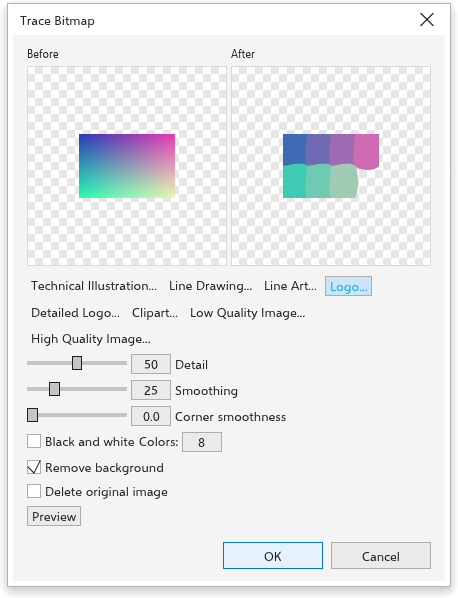

# Vetorizar bitmaps

A vetorização transforma um bitmap em formas vetoriais que você pode editar,
recolorir e escalar sem perder qualidade: um logotipo digitalizado, um esboço,
uma foto.

## Vetorização rápida {#quick-trace}

Selecione um bitmap e escolha [[menu.bitmaps > menu.bitmaps.quick_trace]]. Ela
usa a predefinição escolhida na página [[options.bitmap_tracing]] das opções
globais (Clipart de início).

[[menu.bitmaps.repeat_last_trace]] traça de novo o bitmap selecionado como o último traçado, sem a caixa de diálogo, e [[menu.bitmaps.last_trace_settings]] abre a caixa de diálogo com as configurações do último traçado. O menu do botão direito de um bitmap também tem esses comandos, com [[menu.bitmaps.centerline_trace]] e [[menu.bitmaps.outline_trace]].

## A caixa de diálogo Vetorizar bitmap {#trace}

[[menu.bitmaps > menu.bitmaps.outline_trace]] e
[[menu.bitmaps.centerline_trace]] listam predefinições; escolha uma para abrir a
caixa de diálogo de vetorização.

- **Vetorização de contorno** preenche áreas de cor com formas:
  [[menu.bitmaps.trace_line_art]], [[menu.bitmaps.trace_logo]],
  [[menu.bitmaps.trace_detailed_logo]], [[menu.bitmaps.trace_clipart]],
  [[menu.bitmaps.trace_low_quality]] e [[menu.bitmaps.trace_high_quality]].
- **Vetorização de linha central** segue linhas com curvas abertas:
  [[menu.bitmaps.trace_technical]] e [[menu.bitmaps.trace_line_drawing]].

A caixa de diálogo mostra o bitmap **antes** e a vetorização **depois**,
atualizada conforme você muda as configurações:

- os botões de predefinição no topo;
- **Detalhe** (0 a 100): mais detalhe mantém áreas menores;
- **Suavização** (0 a 100, 25 de início): curvas mais suaves, menos nós;
- **Suavidade dos cantos** (0 a 100): cantos mais redondos;
- **Preto e branco**, ou o número de **Cores** (1 a 256);
- **Remover fundo** (ligado de início): deixa de fora a cor de fundo;
- **Excluir imagem original** (desligado de início);
- **Prévia** conta as curvas da vetorização completa.

Clique em [[dialog.ok]] para vetorizar. As formas são colocadas sobre o bitmap,
as mais escuras primeiro.
