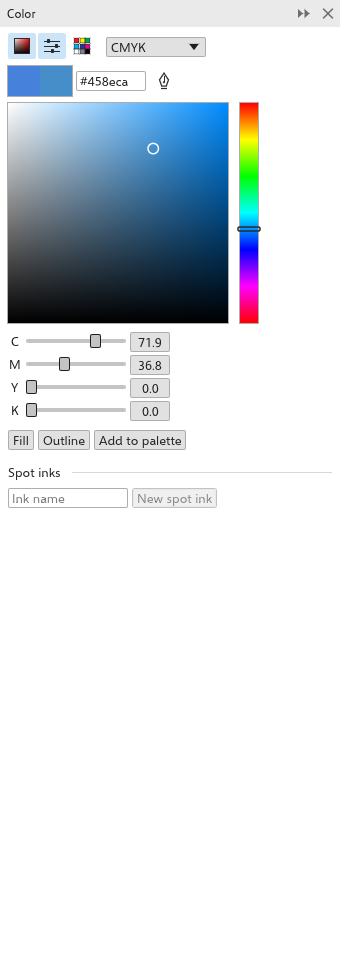

# O painel Cor

O painel [[docker.color]] (<kbd>Shift+F11</kbd>) mistura uma cor e a aplica ao
preenchimento ou ao contorno da seleção. A ferramenta [[tool.outline_color]]
(<kbd>Shift+F12</kbd>) também o abre. Abra-o em
[[menu.window > menu.window.dockers]].

## Escolher uma cor {#choose}

1. Selecione objetos. O painel começa pela cor de preenchimento do primeiro.
2. Misture a nova cor em uma das vistas:
   - [[docker.color_viewers]]: clique ou arraste no quadrado para definir a
     saturação (da esquerda para a direita) e o brilho (de baixo para cima), e
     na faixa ao lado para definir o matiz;
   - [[docker.color_sliders]]: um controle deslizante por componente do
     [[docker.model]]: RGB, CMYK (de início), HSB, HSL, Lab, Escala de cinza ou
     YIQ;
   - [[docker.color_palettes]]: as amostras de uma paleta.

   Os três botões no alto mostram ou ocultam cada vista; qualquer combinação
   pode aparecer. Você também pode digitar um valor `#rrggbb`.
3. Clique em [[docker.fill]] ou [[docker.outline]] embaixo do painel para
   aplicar a nova cor. [[docker.add_to_palette]] a acrescenta à paleta do
   documento.

A cor antiga e a nova aparecem lado a lado. Quando a nova cor não pode ser
impressa exatamente com tintas CMYK, o painel mostra um aviso.

## Amostrar uma cor {#sample}

Clique em [[docker.eyedropper]] e clique em qualquer ponto do desenho para pegar
a cor dali. Depois clique em [[docker.use_sampled]] para torná-la a nova cor.
Veja também [Conta-gotas](eyedroppers.md).

## Tintas especiais {#spot-inks}

Abaixo dos botões, [[docker.spot_inks]] lista as tintas especiais do desenho;
veja [Cores especiais](spot-colors.md).
