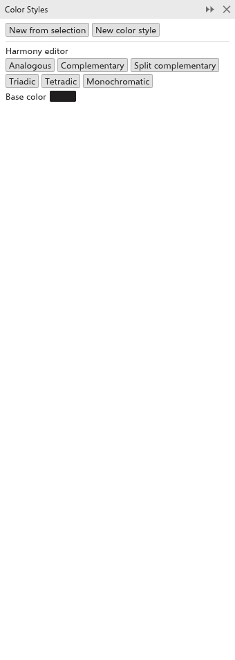

# Estilos de cor

Um **estilo de cor** é uma cor com nome usada pelos objetos do desenho. Mude o
estilo e todo objeto preenchido com ele muda também, o que mantém as cores de
um projeto coerentes e torna rápido experimentar outros esquemas de cores. Os
estilos ficam listados no painel [[docker.color_styles]]; abra-o em
[[menu.window > menu.window.dockers]].

## Criar estilos de cor {#create}

- [[docker.new_from_selection]] acrescenta um estilo para cada cor de
  preenchimento dos objetos selecionados que ainda não é um estilo.
- [[docker.new_color_style]] acrescenta um estilo com a cor atual do painel
  [[docker.color]].

## Usar e editar estilos {#edit}

Cada estilo mostra a cor, o nome e três botões:

- clique na cor para mudá-la: os objetos preenchidos com ela acompanham;
- clique no nome para renomeá-lo;
- [[docker.fill]] preenche a seleção com o estilo, [[docker.outline]] colore o
  contorno dela;
- **x** remove o estilo (os objetos mantêm a cor).

## Harmonias {#harmonies}

O [[docker.harmony_editor]] cria um conjunto de estilos que combinam, a partir
de uma [[docker.base_color]]:

1. Escolha a [[docker.base_color]].
2. Clique em uma harmonia: [[harmony.analogous]], [[harmony.complementary]],
   [[harmony.split_complementary]], [[harmony.triadic]], [[harmony.tetradic]]
   ou [[harmony.monochromatic]].

As cores da harmonia são acrescentadas como estilos, com o nome dela.
