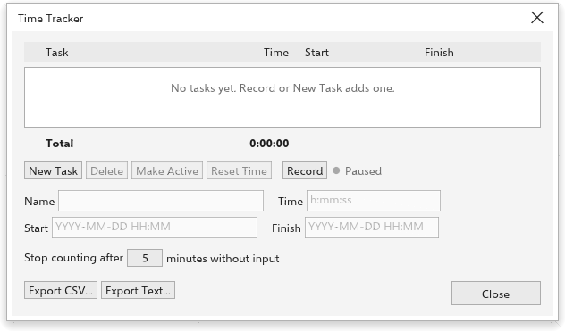

# Controle de tempo

O controle de tempo registra o tempo que você passa em um desenho, tarefa por
tarefa, e guarda os registros no desenho (em arquivos `.tdraw`). O tempo só
conta enquanto você trabalha: depois de alguns minutos parado o relógio espera,
e a sua próxima ação o retoma.

## A barra Controle de tempo {#toolbar}

[[menu.window > menu.window.toolbars > menu.window.toolbar_time_tracker]] mostra
uma barra com:

- a lista de tarefas, para escolher a tarefa ativa ou acrescentar uma nova;
- o tempo da tarefa ativa;
- o botão de gravar e pausar;
- uma luz: vermelha enquanto conta, âmbar enquanto parado, cinza quando
  pausado ou sem tarefa;
- o total de todas as tarefas;
- um botão que abre a caixa de diálogo.

Ligar o relógio em um desenho sem tarefas acrescenta "Task 1".

## A caixa de diálogo Controle de tempo {#dialog}

[[menu.tools > menu.tools.time_tracker]] lista as tarefas com tempo, início e
fim, e o total.

- **Nova tarefa**, **Excluir**, **Tornar ativa** e **Zerar tempo** agem sobre a
  tarefa selecionada. Clique duas vezes em uma tarefa para torná-la ativa.
- **Gravar** e **Pausar** ligam e param o relógio.
- Edite o **nome**, o **tempo** (como `1:30:00`, `1:30` ou `1.5` horas), o
  **início** e o **fim** (como `2026-10-19 14:30`) da tarefa selecionada.
- **Parar de contar após N minutos sem entrada** define o tempo parado (5
  minutos de início).
- **Exportar CSV** e **Exportar texto** salvam os registros, para uma planilha
  ou um relatório.

Registrar tempo não é uma edição do desenho: não cria passo de desfazer. Os
registros são salvos no próximo salvamento do desenho.
