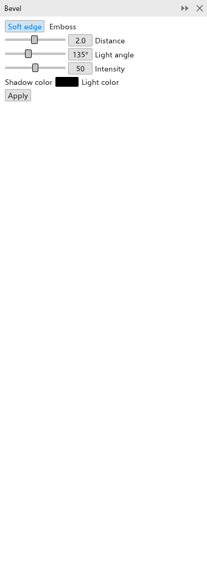

# Chanfros

Um chanfro faz as bordas de um objeto parecerem em relevo ou entalhadas,
iluminando um lado da borda e sombreando o outro. É um efeito vivo, definido no
painel [[docker.bevel]]; abra-o com [[menu.effects > menu.effects.bevel]].

## Para chanfrar um objeto {#create}

1. Selecione um objeto preenchido.
2. No painel [[docker.bevel]], escolha o estilo:
   - [[docker.soft_edge]]: a borda desce para dentro do objeto, iluminada de um
     lado e sombreada do outro;
   - [[docker.emboss]]: o objeto parece saltar da página.
3. Defina a [[docker.distance]] (até onde o chanfro entra no objeto), o
   [[docker.light_angle]], a [[docker.intensity]] da luz, a
   [[docker.shadow_color]] e a [[docker.light_color]].
4. Clique em [[docker.apply]].

Para copiar o chanfro de outro objeto, use
[[menu.object > menu.object.copy_effect > menu.object.copy_bevel_from]].
[[menu.object > menu.object.clear_effect]] o remove. O painel de extrusão
também tem um chanfro para a face da frente; veja
[Extrusões](extrude.md#settings).
