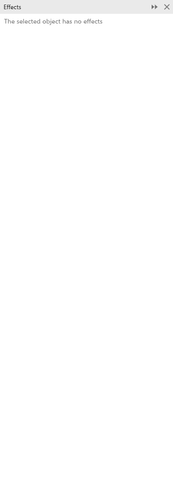

# O painel Efeitos

Um objeto pode ter vários efeitos vivos ao mesmo tempo, aplicados um depois do
outro. O painel [[docker.effects]] lista os efeitos do objeto selecionado na
ordem em que são aplicados, de cima para baixo. Abra-o com
[[menu.window > menu.window.dockers > menu.window.dockers_effects]].

## Gerenciar efeitos {#stack}

Cada linha da lista tem:

- uma caixa de seleção que ativa ou desativa o efeito. Um efeito desativado
  mantém o lugar e as configurações, mas não é desenhado, exportado nem
  impresso;
- o nome do efeito, esmaecido enquanto está desativado;
- setas para cima e para baixo que movem o efeito para antes ou depois, o que
  muda o resultado (por exemplo, um contorno de um envelope, ou um envelope de
  um contorno);
- um X que remove o efeito.

Cada alteração é um passo de desfazer. Cada efeito continua sendo editado com a
própria ferramenta ou painel.

## Outros comandos de efeito {#commands}

- [[menu.effects > menu.effects.flatten]] transforma os efeitos dos objetos
  selecionados em objetos simples.
- [[menu.effects.picker]] mostra uma lista de efeitos para aplicar à seleção.
- [[menu.object > menu.object.clear_effect]] remove o efeito da seleção.
- [[menu.object > menu.object.copy_effect]] copia um efeito de outro objeto, e
  [[menu.object.clone_effect]] faz um clone que o acompanha; veja
  [Copiar e clonar efeitos](copy-and-clone.md).
