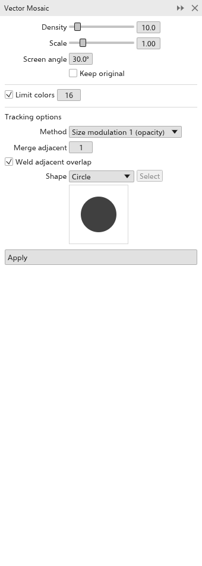
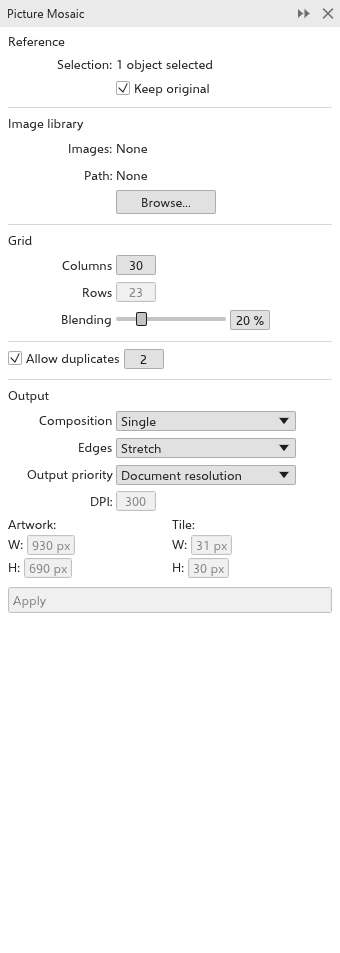

# Mosaicos vetoriais e de imagens

Um mosaico reconstrói os objetos selecionados, ou uma imagem, com muitos
ladrilhos pequenos. Um **mosaico vetorial** usa formas coloridas; um **mosaico
de imagens** usa fotos de uma pasta sua.

## Mosaico vetorial {#vector-mosaic}

Abra o painel [[docker.vector_mosaic]] com
[[menu.effects > menu.effects.vector_mosaic]].

1. Selecione os objetos ou bitmaps a transformar em mosaico.
2. Defina as opções:
   - **Densidade**: ladrilhos por polegada (10 de início); **Escala**: o
     tamanho de cada ladrilho dentro da célula (1 de início); **Ângulo da
     retícula**: como as fileiras são giradas (30 graus de início).
   - **Manter original**: desligado, exclui a seleção depois de fazer o
     mosaico.
   - **Limitar cores**: reduz os ladrilhos a no máximo esse número de cores
     (16 de início).
   - **Método**: **Uniforme** (todo ladrilho no tamanho cheio, transparência
     achatada sobre branco), **Modulação de tamanho 1** (o tamanho do ladrilho
     segue a opacidade, de início) ou **Modulação de tamanho 2** (áreas mais
     escuras dão ladrilhos maiores).
   - **Mesclar vizinhos**: junta até esse número de ladrilhos vizinhos de uma
     mesma cor; **Soldar sobreposição de vizinhos**: uma curva por cor em vez
     de um objeto por ladrilho.
   - **Forma**: círculo (de início), quadrado ou personalizada. Para um
     ladrilho personalizado, selecione uma curva fechada e clique em
     **Selecionar**.
3. Clique em [[docker.apply]].

O mosaico é um grupo colocado por cima da seleção, e fica selecionado.

## Mosaico de imagens {#picture-mosaic}

Abra o painel [[docker.picture_mosaic]] com
[[menu.effects > menu.effects.picture_mosaic]].

1. Selecione os objetos ou bitmaps a reconstruir.
2. Em **Biblioteca**, clique em **Procurar** e escolha uma pasta de imagens
   (PNG, JPEG, BMP, GIF, WebP ou TIFF; até 1000). O painel mostra quantas ela
   tem.
3. Defina as opções:
   - **Manter original** (ligado de início).
   - **Colunas**: ladrilhos na largura (30 de início); as fileiras saem da
     forma da seleção. **Mistura**: quanto da seleção aparece sobre os
     ladrilhos (20% de início).
   - **Permitir repetições** (ligado), com o **espaçamento entre ladrilhos**:
     o mínimo de ladrilhos entre dois usos de uma mesma imagem.
   - **Composição**: simples, pilha ou matriz; **Bordas**: esticar a última
     fileira ou removê-la; **Prioridade de saída** e a resolução: o tamanho do
     mosaico em pixels. O painel mostra o tamanho resultante.
4. Clique em [[docker.apply]].

> **Observação:** As bibliotecas de imagens precisam da versão para desktop; a
> versão para navegador não lê pastas.
