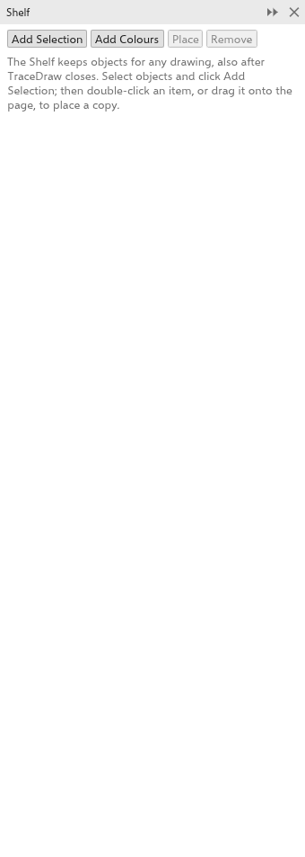
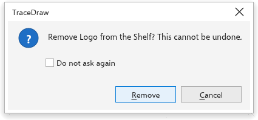

# A Prateleira

O painel [[docker.shelf]] guarda objetos e cores fora de qualquer desenho, para
você colocá-los neste desenho ou em outro, hoje ou depois que o TraceDraw
reiniciar: logotipos, carimbos, molduras, um conjunto de cores. Abra-o em
[[menu.window > menu.window.dockers]], ou clique com o botão direito em uma
seleção e escolha [[menu.object.add_to_shelf]].

## Acrescentar à Prateleira {#add}

- Selecione objetos e clique em [[shelf.add_selection]]. O item recebe o nome
  do objeto (o nome dele, ou o que ele é), ou "n objetos". Símbolos viram
  objetos simples, e os estilos de objeto que eles usam vão junto.
- Clique em [[shelf.add_colors]] para guardar as cores da paleta do documento e
  os estilos de cor do desenho como um item.

A Prateleira guarda até 500 itens.

## Colocar um item {#place}

- Arraste um item até o desenho para colocar uma cópia sob o ponteiro.
- Clique duas vezes em um item, ou escolha-o e clique em [[shelf.place]], para
  colocar uma cópia no meio da vista.

As cópias vão para a camada ativa e ficam selecionadas; um desfazer as remove.
Um item de cores acrescenta as cores à paleta do documento e os estilos de cor
ao desenho.

## Organizar os itens {#arrange}

- Clique em um item para escolhê-lo. Clique com o botão direito nele para
  [[shelf.place]], [[shelf.rename]] e [[shelf.remove]].
- Arraste um item sobre outro para movê-lo para esse lugar.

### Remover um item {#remove}

Escolha um item e clique em [[shelf.remove]]. A remoção não pode ser desfeita,
então o TraceDraw pergunta antes: clique em [[shelf.remove]] para confirmar ou
em [[dialog.cancel]] para mantê-lo. Marque [[shelf.dont_ask]] para remover
itens sem perguntar; para voltar a ser perguntado, ative
[[options.warn_shelf_remove]] na página [[options.warnings]] das opções
globais.

## Onde a Prateleira fica guardada {#storage}

No computador, a Prateleira é um arquivo na sua pasta de preferências. No
navegador, ela fica no armazenamento daquele navegador, que guarda só alguns
megabytes, então bitmaps grandes podem não ser guardados.
