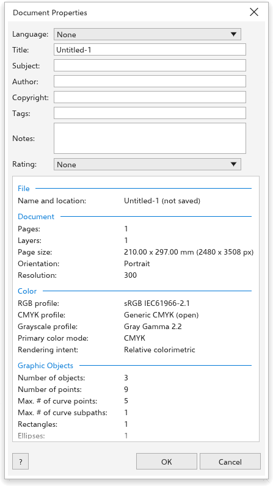

# Propriedades do documento

[[menu.file > menu.file.document_properties]] abre a caixa de diálogo
[[docprops.title]]. Ela guarda informações sobre o desenho, como o título e o
autor, e relata tudo o que o desenho contém.

## Descrever o desenho {#fields}

- **Idioma**: o idioma do texto do desenho, ou nenhum. Arquivos PDF gravados a
  partir do desenho o levam, o que ajuda os leitores de tela.
- [[dialog.title]], [[dialog.subject]], **Autor**, **Direitos autorais**,
  [[docprops.tags]] (palavras-chave gravadas em arquivos PDF e SVG) e **Notas**
  (várias linhas).
- [[dialog.rating]]: nenhuma ou de uma a cinco estrelas.

Clique em [[dialog.ok]] para manter as alterações, como um passo de desfazer.
[[dialog.cancel]] deixa tudo como estava. O título, o assunto e a
classificação também podem ser definidos ao salvar; veja
[Salvar como](../get-started/open-and-save.md#save-as).

## O relatório {#report}

Abaixo dos campos, um relatório lista o que o desenho contém, em seções:

- [[docprops.sec_file]]: o nome e o local do arquivo.
- [[docprops.sec_document]]: as páginas e camadas, o tamanho da página (nas
  unidades de desenho e em pixels), a orientação e a resolução.
- [[docprops.sec_color]]: os perfis de cor, o modo de cor principal e a
  intenção de renderização.
- [[docprops.sec_objects]]: o número de objetos e de pontos, o máximo de pontos
  e partes de uma curva, e as curvas, retângulos, elipses, polígonos, grupos e
  tabelas.
- [[docprops.sec_text]]: textos artísticos e de parágrafo, caracteres, palavras
  e as fontes usadas.
- [[docprops.sec_bitmaps]]: o número de bitmaps, o total de pixels e o maior
  deles.
- [[docprops.sec_styles]]: estilos de objeto e de cor.
- [[docprops.sec_effects]]: cada efeito, com quantos objetos o usam.
- [[docprops.sec_fills]] e [[docprops.sec_outlines]]: os objetos por tipo de
  preenchimento e de contorno, e quantos usam cada modelo de cor.
- [[docprops.sec_symbols]]: símbolos definidos e instâncias colocadas.

O relatório ajuda antes de mandar um arquivo para impressão: por exemplo, ele
mostra de quais fontes o desenho precisa e se ele tem cores RGB. Para uma
verificação completa, veja [Verificação prévia](../printing/preflight.md).
