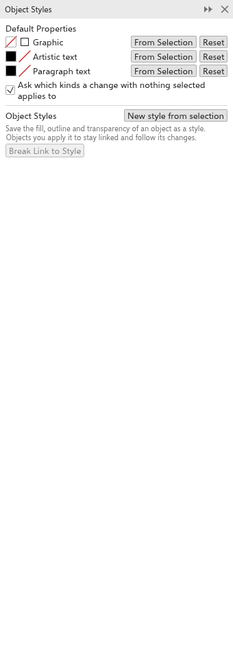
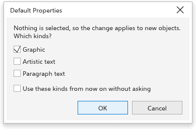

# Estilos de objeto e propriedades padrão

O painel [[docker.object_styles]] tem duas partes: as [[defaults.title]] dos
novos objetos e os estilos do desenho. As duas são salvas com o desenho. Abra-o
em [[menu.window > menu.window.dockers]], ou clique com o botão direito em um
objeto e escolha o painel de estilos de objeto.

## Propriedades padrão {#defaults}

Novos objetos recebem o preenchimento e o contorno do seu tipo:

| Tipo | Em um desenho novo |
|---|---|
| [[defaults.graphic]]: formas, linhas, tabelas e tudo menos texto | sem preenchimento, um contorno preto fino |
| [[defaults.artistic_text]]: texto sem moldura | preenchimento preto, sem contorno |
| [[defaults.paragraph_text]]: texto em uma moldura | preenchimento preto, sem contorno |

No painel, cada tipo mostra o preenchimento e o contorno, com
[[docker.from_selection]] (pega o preenchimento e o contorno do objeto
selecionado) e [[docker.reset]] (volta aos padrões de um desenho novo).

### Mudar os padrões sem nada selecionado {#document-defaults}

Quando nada está selecionado e você escolhe um preenchimento ou contorno
(clica em uma cor da paleta, usa uma ferramenta de preenchimento, muda a cor ou
a largura do contorno), a mudança vale para os novos objetos. O Rui
pergunta a quais tipos de novos objetos ela se aplica:

1. Marque [[defaults.graphic]], [[defaults.artistic_text]] e
   [[defaults.paragraph_text]] conforme necessário. Os tipos marcados da última
   vez vêm marcados.
2. Marque [[defaults.dont_ask]] para pular a pergunta daqui em diante.
3. Clique em [[dialog.ok]]. [[dialog.cancel]] não muda nada.

A caixa [[defaults.ask]] no painel ativa ou desativa a pergunta. O painel
[[docker.properties]] sem nada selecionado também edita os padrões de
[[defaults.graphic]]. Para manter os padrões em todo desenho novo, escolha
[[menu.tools > menu.tools.save_settings_as_default]].

## Estilos {#styles}

Um estilo é um conjunto com nome de propriedades: [[docker.style_fill]],
[[docker.style_outline]] (cor, largura, estilo de linha e setas) e
[[docker.style_transparency]]. Os objetos a que você dá um estilo continuam
ligados a ele: mude o estilo e todos mudam.

### Para criar um estilo {#create}

1. Selecione um objeto com a aparência desejada.
2. Clique em [[docker.new_style_from_selection]].

O estilo recebe o nome "Estilo 1" e assim por diante, pega o preenchimento, o
contorno e a transparência do objeto e fica ligado a todos os objetos
selecionados.

### Usar e mudar estilos {#use}

Cada estilo mostra as amostras, o nome (clique para renomear), quantos objetos
estão ligados a ele e as partes como caixas de seleção:

- [[docker.apply]] dá o estilo à seleção e a liga a ele.
- [[docker.update_from_selection]] pega o preenchimento, o contorno e a
  transparência do objeto selecionado; todo objeto ligado acompanha.
- Desmarcar uma parte deixa essa propriedade a cargo de cada objeto.
- [[docker.delete]] remove o estilo; os objetos ligados mantêm a aparência.
- [[docker.break_style_link]] desliga os objetos selecionados, que mantêm a
  aparência.

Você ainda pode mudar um objeto ligado diretamente; a próxima mudança do estilo
volta a aplicar as partes dele. Clique com o botão direito em um objeto para
aplicar um estilo pelo menu.
