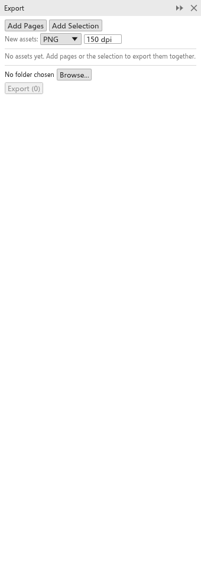

# O painel Exportar

O painel [[docker.export]] mantém uma lista de **recursos** (páginas e objetos)
e exporta todos de uma vez, cada um no seu formato, para uma pasta: os ícones de
um aplicativo em vários tamanhos, todas as páginas de uma série de posts para
redes sociais. Abra-o em [[menu.window > menu.window.dockers]].

## Acrescentar recursos {#assets}

- **Adicionar páginas** acrescenta todas as páginas do desenho, com o nome da
  página.
- **Adicionar seleção** acrescenta os objetos selecionados como um recurso,
  recortado neles, com o nome do objeto.
- Os recursos novos recebem o formato e a resolução definidos em **Novos
  recursos** (PNG a 150 dpi de início).

Cada recurso tem uma marca (só os marcados são exportados), o nome (o nome do
arquivo), o formato, a resolução para formatos de bitmap (72 a 2400 dpi) e um X
para removê-lo. O link abaixo do nome vai para a página ou seleciona os
objetos.

## Exportar {#export}

1. Clique em **Procurar** para escolher a pasta (a primeira exportação pede
   uma).
2. Clique em **Exportar**. O botão mostra quantos recursos serão gravados.

Caracteres que não podem estar em nomes de arquivo viram `_`, e dois recursos
com o mesmo nome recebem " (2)", " (3)" e assim por diante. A barra de status
diz quantos arquivos foram gravados. No navegador, cada arquivo é baixado.
