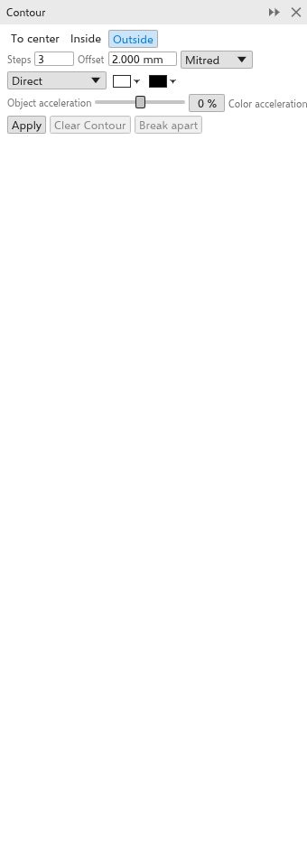

# Контуры

Контур рисует равномерно отстоящие копии абриса объекта внутри него, снаружи
или к его центру, как линии на карте. Это живой эффект: измените объект, и
контур последует за ним.

## Добавление контура {#create}

Инструментом:

1. Выберите инструмент [[tool.contour]] в выпадающей группе «Эффекты».
2. Перетащите от объекта: от его середины для внешнего контура, к ней для
   внутреннего. Чем дальше вы тянете, тем больше интервал.

Панелью:

1. Выделите объект.
2. Откройте панель [[docker.contour]] через
   [[menu.effects > menu.effects.contour]] (<kbd>Ctrl+F9</kbd>).
3. Задайте параметры и нажмите [[docker.apply]].

Группы и растровые изображения не могут получить контур.

## Параметры контура {#settings}

Панель свойств и панель показывают параметры выделенного контура и сразу
меняют его.

- **К центру**, **Внутрь** или **Наружу** (по умолчанию).
- **Шаги**: по умолчанию 3, не более 999. «К центру» создаёт столько, сколько
  поместится.
- **Смещение**: расстояние между шагами (по умолчанию 2 мм).
- **Углы**: острые (по умолчанию), скруглённые или срезанные.
- **Направление цвета**: прямо, по часовой стрелке или против неё по
  цветовому кругу, от цветов объекта к цветам последнего шага.
- **Цвета заливки и абриса последнего шага** (по умолчанию белый и чёрный).
  Объект без заливки даёт шаги без заливки.
- **Ускорение объектов** и **ускорение цвета** (от -100 до 100%) сгущают шаги
  или цвета к объекту или к последнему шагу.

Внешние шаги рисуются за объектом, внутренние перед ним.

**Убрать контур** удаляет контур; **Разъединить** превращает шаги в
объекты.
Шаги выходят сгруппированными рядом с объектом. [[menu.object > menu.object.break_contour_apart]] (<kbd>Ctrl+K</kbd>,
также в контекстном меню) делает то же самое.
