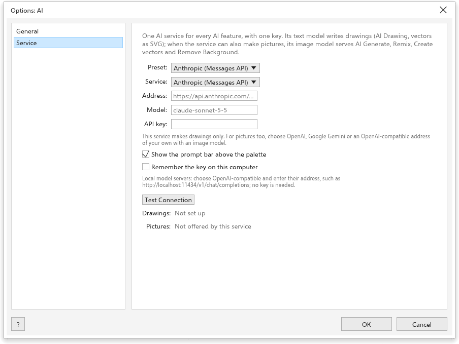
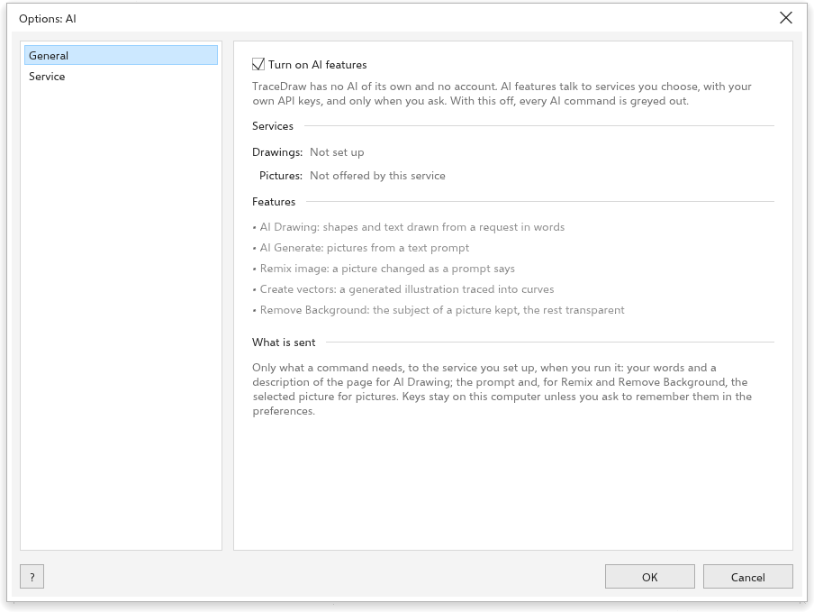
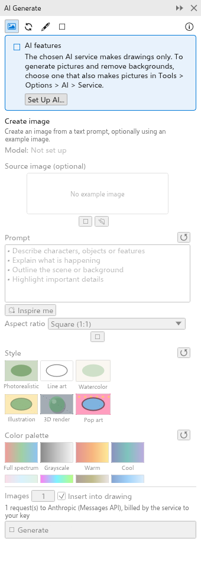

# AI 繪圖和生成

TraceDraw 可以根據文字描述繪圖，並使用您選擇、以您自己的金鑰設定的 AI 服務來產生圖片。TraceDraw 本身沒有 AI，也不需要帳號：在您執行 AI 指令之前不會傳送任何內容，執行時也只會將該指令所需的內容傳送到您設定的服務。每個要求都由您的服務計費；在您電腦上執行的本機模型伺服器則不需任何費用。

## 設定 AI 服務 {#service}

[[menu.tools > menu.tools.options > menu.tools.options_ai]] 有兩個頁面。

在**服務**頁面上，為所有 AI 功能設定一個 AI 服務：

1. 選擇一個**預設集**：Anthropic、OpenAI、Google Gemini，或您電腦上的模型伺服器（Ollama、LM Studio、llama.cpp server、vLLM）。預設集會填入服務種類和位址；**自訂**可使用任何與 OpenAI 的 chat completions 使用相同介面的位址。
2. 輸入您在該服務的帳號的 **API 金鑰**（本機伺服器不需要）。勾選**在這台電腦上記住金鑰**即可保留它；此時金鑰會以純文字儲存在您的偏好設定中。
3. 選擇**模型**，若服務能產生圖片（OpenAI、Google Gemini，或具有影像模型的自訂位址），也選擇**影像模型**。
4. 按一下 [[aiui.test]]。它會向服務查詢其模型，並告訴您有多少個，或顯示其錯誤。

**顯示提示列**會將 AI 提示列放在調色盤上方。

## 一般 {#general}

- [[aiui.enable]]（開啟）：關閉時，所有 AI 指令都會呈灰色。
- [[aiui.services]]：[[aiui.drawings]] 和 [[aiui.pictures]] 是 [[aiui.ready]] 還是 [[aiui.not_ready]]。
- [[aiui.features]]：每個 AI 指令的用途。
- [[aiui.privacy_title]]：只有在您執行指令時，才會將該指令所需的內容傳送到您設定的服務。

## 以文字繪圖 {#draw-with-words}

在提示列中，或在 [[docker.ai_generate]] 面板（[[menu.object > menu.object.ai_generate > menu.object.ai_draw_words]]）的**以文字繪圖**模式中，輸入要求，例如「一輛有藍色輪子的紅色腳踏車」或「把圓形放大，並把標題放在它下面」，然後按**繪製**或 <kbd>Enter</kbd>。服務會為繪圖撰寫指令碼，TraceDraw 會以一個復原步驟執行它。對話會保留下來，因此您可以要求修改；**新對話**會重新開始。**在指令碼中開啟**會顯示指令碼。

## AI 生成面板 {#generate}

[[docker.ai_generate]] 面板（[[menu.tools > menu.tools.ai_generate]]，或標準工具列上的「AI 生成」按鈕）會使用您服務的影像模型來產生圖片。

使用頂端的按鈕選擇模式：

- **建立影像**：根據描述產生圖片。**給我靈感**會填入一個點子。選擇長寬比。
- **重新混合影像**：依照您的描述修改圖片（預設為選取的點陣圖）。現成的要求包括樣品模型、修復相片、為草圖上色、取代背景、變更季節和重新上色。
- **建立向量**：將插圖轉換為可編輯的形狀，可以是描繪成曲線的圖片，或由文字模型撰寫的 SVG 繪圖。
- **以文字繪圖**（請參閱上文）。

每個模式都有**模型**、選用的參考圖片（**使用選取範圍**或**匯入檔案**）、**提示**，以及**樣式**和**調色盤**圖塊。在底部設定**影像**數量（1 到 4）和**插入繪圖**，然後按一下**生成**。結果會保留在面板中；按一下其中一個即可插入。

## 其他 AI 指令 {#other}

- [[menu.bitmaps > menu.bitmaps.remove_background]] 會保留圖片的主體，並讓其餘部分變成透明。
- [[menu.bitmaps.ai_art_styles]] 會以八種樣式之一重新繪製選取範圍。

當 AI 已關閉或尚未設定時，這些指令會呈灰色，其提示會說明原因；[[aiui.set_up]] 按鈕會開啟對應的選項頁面。
