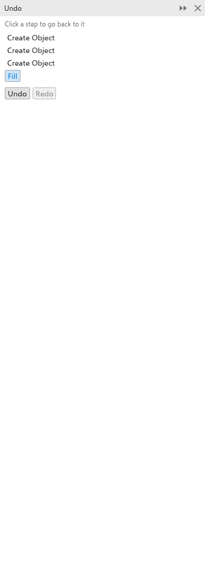

# 復原、縮放和平移

您可以復原任何變更，並以任何縮放比例、從任何位置檢視您的繪圖。縮放和平移永遠不會變更繪圖。

## 復原和重做 {#undo}

- [[menu.edit > menu.edit.undo]]（<kbd>Ctrl+Z</kbd>）會取消上一個變更；[[menu.edit.redo]]（<kbd>Ctrl+Shift+Z</kbd>）會再次執行它。
- 標準工具列上「復原」和「重做」旁邊的箭頭會列出各個步驟。選擇一個步驟，即可復原或重做到該步驟為止的所有變更。
- [[menu.edit.repeat]] 會再次套用上一個指令，例如套用到您選取的下一個物件。

### 復原面板 {#undo-docker}

[[docker.undo]] 面板會列出繪圖的每個變更，最舊的在最前面。按一下某個步驟，可讓繪圖回到該步驟之後的狀態；按一下較後面的步驟則可再次前進。從 [[menu.window > menu.window.dockers]] 開啟它。

## 縮放 {#zoom}

- 轉動滑鼠滾輪，即可以指標為中心放大或縮小。
- 使用標準工具列上的縮放方塊：輸入比例，或從其清單中選擇（10% 到 1600%），或縮放至選取範圍、所有物件、頁面、頁面寬度或頁面高度。
- [[menu.view > menu.view.zoom_in]] 和 [[menu.view.zoom_out]] 會縮放一級；[[menu.view.zoom_to_fit]]（<kbd>F4</kbd>）會顯示所有物件，[[menu.view.zoom_to_page]]（<kbd>Shift+F4</kbd>）顯示頁面，[[menu.view.zoom_to_selected]]（<kbd>Shift+F2</kbd>）顯示選取範圍。
- 在觸控板上以雙指捏合可縮放；在觸控螢幕上，無論使用哪個工具，都可以用兩指平移和捏合。

### 縮放工具 {#zoom-tool}

選擇 [[tool.zoom]] 工具（<kbd>Z</kbd> 或 <kbd>F2</kbd>），然後：

- 按一下可在該點放大兩倍；
- <kbd>Shift</kbd>+按一下或按一下右鍵可縮小兩倍；
- 拖曳出一個矩形，可縮放至該矩形填滿視窗。

按兩下工具的按鈕，可縮放至符合所有物件。

## 平移 {#pan}

- 使用任何工具時，按住滑鼠中鍵並拖曳。
- 選擇 [[tool.pan]] 工具（<kbd>H</kbd>）並拖曳。
- <kbd>Ctrl</kbd>+滾輪可上下捲動，<kbd>Alt</kbd>+滾輪可左右捲動。
- 使用捲軸，其範圍涵蓋頁面及其周圍一個頁面大小的區域。
- 按住捲軸之間角落的「導覽器」按鈕，並將指標移到頁面縮圖上。
- <kbd>PgUp</kbd> 和 <kbd>PgDn</kbd> 可前往上一頁和下一頁。

若要讓滾輪捲動而不是縮放，請在 [[menu.tools > menu.tools.options > menu.tools.options_tools]] 的 [[options.zoom_pan]] 頁面上變更滑鼠滾輪動作。之後滾輪會捲動，<kbd>Shift</kbd>+滾輪會左右捲動，<kbd>Ctrl</kbd>+滾輪則會縮放。請參閱[工具選項](../customize/tool-options.md#zoom-pan)。

## 檢視 {#views}

[[menu.view]] 選單用來選擇物件的繪製方式：[[menu.view.wireframe]] 只顯示外框，[[menu.view.normal]] 和 [[menu.view.enhanced]] 會繪製填色和效果，[[menu.view.pixels]] 則會以匯出時的像素顯示繪圖。[[menu.view.fullscreen_preview]] 會在螢幕上單獨顯示頁面；按任意鍵即可返回。[[menu.view.preview_selected_only]] 會將該預覽限制為選取範圍。[[menu.view]] 選單也可以顯示或隱藏尺規、格點、參考線、出血和可列印區域；請參閱[尺規、格點和參考線](../pages-layout/guidelines-and-grid.md)。
